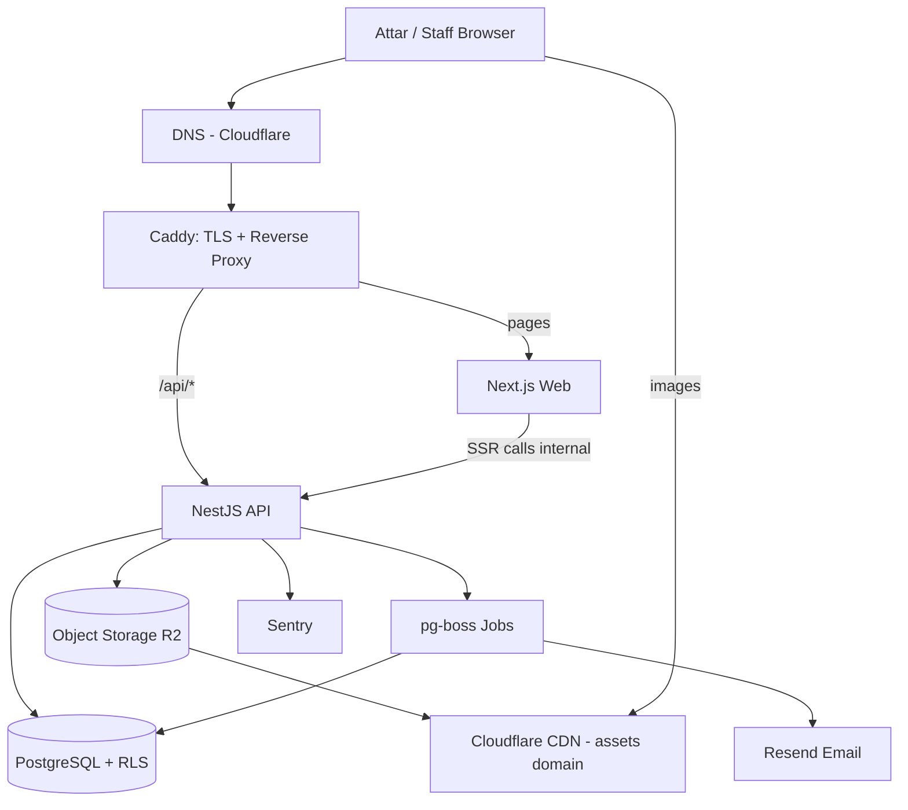
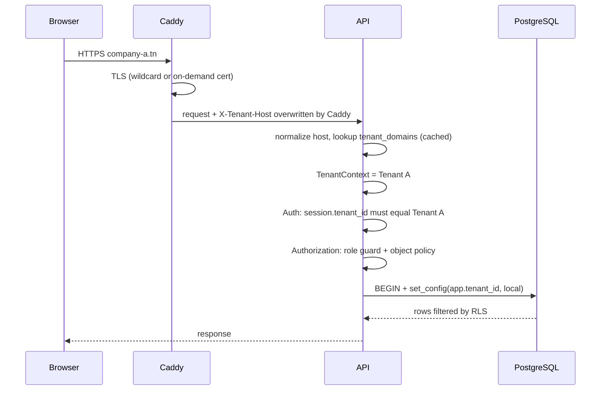
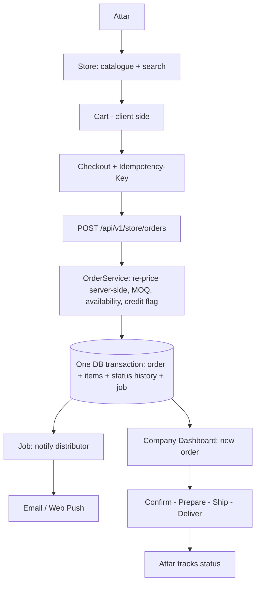
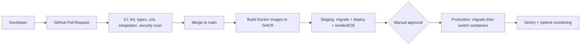
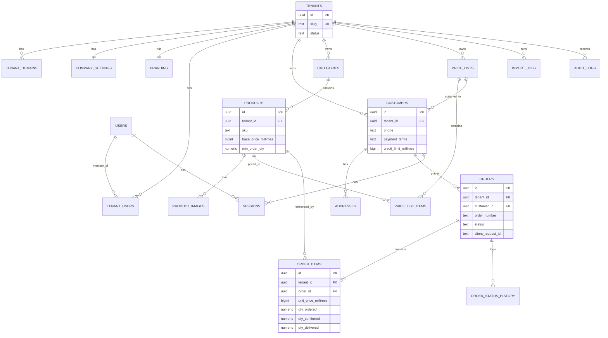

# Technical Blueprint: منصة B2B للتوزيع (White-label Multi-Tenant)

> **الحالة:** v1.0، أكتوبر 2026
> **النطاق:** Distributor → Attar فقط. لا مصانع، لا Marketplace.
>
> **الفرضيات المستعملة:**
> - **Fact:** أسعار DigitalOcean في القسم 19 تحققت منها من مصادر منشورة في 2026.
> - **Assumption:** باقي الأرقام تقديرية وتحتاج Validation.
> - **Assumption:** المطوّر يتقن TypeScript. إن كان خبيرًا في Laravel أو Django فقد يتغيّر قرار الـBackend فقط.

---

## فهرس

1. Executive Technical Summary
2. Architecture Decision
3. Final Technology Stack + ADRs
4. Multi-Tenant Strategy
5. System Architecture (+ 4 Diagrams)
6. Database Architecture (+ ERD)
7. Backend Architecture
8. Frontend Architecture
9. Authentication & Authorization
10. Security
11. Infrastructure
12. Custom Domains
13. API Architecture
14. Testing
15. CI/CD + Backup/DR
16. Observability
17. Performance (Cache / Queue / Search)
18. Scalability
19. Cost
20. Implementation Roadmap + Definition of Done
21. Final Blueprint

---

## 1. Executive Technical Summary

بفريق من مطوّر واحد وميزانية صغيرة، نبني **Modular Monolith** بلغة TypeScript. يتكوّن من تطبيقين: Next.js للواجهات وNestJS للـAPI. فوقهما PostgreSQL واحدة بـ`tenant_id` وبحماية **Row-Level Security**. يُنشر الكل بـDocker Compose على خادم واحد، ويُبنى بحيث ينتقل من 10 إلى 1,000 شركة دون إعادة كتابة.

### قرارات تخالف ما اقتُرح سابقًا أو ما طُلب، وسببها

| القرار | السبب |
|---|---|
| **Custom Auth بجلسات في DB** بدل Auth.js/Supabase | العطار يدخل برقم هاتف وليس إيميل، وهويته مرتبطة بشركة واحدة فقط. كما أن Auth خارجي يعقّد مسألة قانون INPDP |
| **هوية العطار Tenant-scoped وليست عالمية** | الموزعون منافسون. عطار يشتري من شركتين يجب ألا يربط النظام حسابيه أبدًا |
| **لا جداول roles/permissions في الـMVP** | الأدوار 4 ثابتة، والصلاحيات تُعرَّف في الكود. الجداول تُضاف عند الحاجة لأدوار مخصصة |
| **Next.js ليس لأجل SEO** | المتجر خلف تسجيل دخول ولا يحتاج SEO. أسبابه: Branding من أول Render، وManifest خاص بكل شركة (PWA)، وتجربة تطوير جيدة |
| **إدخال طلب هاتفي من الـDashboard في الـMVP** | وإلا سيعمل الموزع بنظامين في الـPilot، ولن نستطيع قياس Online vs Phone |
| **ترتيب البناء: Ordering قبل Custom Domains** | Custom Domains لا تثبت أي Hypothesis، فتأتي بعد بدء الـPilot |
| **مدة MVP: 12–14 أسبوعًا لمطوّر واحد** | 8–10 أسابيع ممكنة فقط بتقليص النطاق (بلا Web Push، وبلا Custom Domains) |

### 3 بوابات قرار (Decision Gates) خارج الكود

- **G1، الاستضافة والقانون:** كما رأينا في مراجعة القانون (2004-63)، الاستضافة في الخارج تتطلب على الأرجح ترخيص INPDP (الفصل 52). القرار الافتراضي استضافة في أوروبا، لكن الـArchitecture Portable. **لا تُدخل بيانات حقيقية قبل حسم G1.**
- **G2، نطاقات .tn:** هل يتيح المسجّل إعداد A/CNAME Records؟ ما التكلفة والشروط؟ (Assumption).
- **G3، الخبرة:** تأكيد أن المطوّر مرتاح مع TypeScript/NestJS.

---

## 2. Architecture Decision

| المعيار | Monolith | **Modular Monolith** | Microservices |
|---|---|---|---|
| سرعة التطوير | الأعلى | عالية | الأقل |
| التعقيد | منخفض، ثم يتحول لـSpaghetti | منخفض مع انضباط | عالٍ جدًا |
| مناسبة لمطوّر واحد | نعم | **نعم** | لا |
| التكلفة | الأدنى | الأدنى | أعلى بوضوح |
| النشر والاختبار | بسيط | بسيط | معقد (Contracts، Tracing) |
| التوسع | عمودي فقط | عمودي + أفقي (Stateless) | أفقي مرن |
| الصيانة طويلة المدى | تتدهور | **جيدة إن فُرضت الحدود** | جيدة، بكلفة تشغيل عالية |

**القرار النهائي: Modular Monolith**، بنشرين (Deployables) من نفس الـRepo:

1. `web`: Next.js.
2. `api`: NestJS، ويشمل Worker للـJobs في نفس العملية في البداية. ينفصل لاحقًا بنفس الـImage وأمر تشغيل مختلف.

**كيف نمنع Spaghetti:** كل Module يعرض Public API واحدًا (Service)، ولا يقرأ جداول Module آخر مباشرة. تُفرض القاعدة بأداة `dependency-cruiser` في الـCI، فيفشل الـBuild عند خرقها.

---

## 3. Final Technology Stack

### 3.1 المقارنات والقرارات

| المكوّن | القرار | البدائل ولماذا رُفضت |
|---|---|---|
| **Frontend** | **Next.js (App Router) + TypeScript + Tailwind + shadcn/ui + TanStack Query + next-intl** | *React SPA (Vite):* أبسط، لكن Branding وManifest لكل شركة يحتاجان Server-side. *Vue/Nuxt:* ممتازان لكن Ecosystem ومطورو تونس والمكتبات أقل لنفس الغرض |
| **Backend** | **NestJS (Fastify) + TypeScript** | *Next API Routes:* لا Modules ولا Guards ولا Jobs. *FastAPI/Django:* لغة ثانية بلا فائدة هنا. *Laravel:* بديل مشروع إن كان المطوّر خبيرًا فيه |
| **Database** | **PostgreSQL** | *MySQL:* بلا RLS أصلي. *MongoDB:* بيانات علائقية بالكامل |
| **ORM** | **Drizzle** | *Prisma:* بديل جيد، لكن Drizzle أقرب للـSQL ويدعم Partial Indexes وComposite FKs وسياسات RLS. *TypeORM:* Type safety أضعف |
| **Authentication** | **Custom Session Auth** (argon2id + جلسات في DB) | *Clerk:* تسعير MAU ولا يناسب Phone+Password per Tenant. *Supabase/Firebase:* Lock-in وبيانات هوية في الخارج. *Auth.js:* مصمم لـJWT/OAuth |
| **Authorization** | **RBAC في الكود + Policies على الكائن + RLS** | القسم 9 |
| **Multi-Tenancy** | **Shared DB + Shared Schema + `tenant_id` + RLS** | القسم 4 |
| **Queue** | **pg-boss** (طابور فوق PostgreSQL) | *Redis/BullMQ:* بنية إضافية بلا حاجة |
| **Search** | **PostgreSQL: `pg_trgm` + `unaccent`** | *Meilisearch/Algolia/OpenSearch:* لا مشكلة بحث بعد |
| **Cache** | **لا Redis.** In-memory LRU صغير لنطاقات Tenants (TTL=60 ثانية) | القسم 17 |
| **Hosting** | **DigitalOcean (FRA1): Droplet + Managed PostgreSQL** | *Vercel:* تسعير لكل مقعد وبلا DB. *Railway/Render:* تحكم أقل وتكلفة أعلى. *AWS:* تعقيد بلا حاجة. *Supabase:* Lock-in. *Hetzner:* بلا Managed PostgreSQL |
| **Reverse Proxy / TLS** | **Caddy** | *Nginx+Certbot:* لا On-demand TLS سهل. *Cloudflare for SaaS:* تكلفة وتعقيد قبل الحاجة |
| **DNS** | **Cloudflare DNS** (للنطاق الرئيسي للمنصة) | مطلوب لشهادة Wildcard بـDNS-01 |
| **Object Storage + CDN** | **Cloudflare R2** (S3-compatible) | *S3:* رسوم Egress. *Supabase Storage/Cloudinary:* Lock-in أو تكلفة. *DO Spaces:* بديل مقبول |
| **Email** | **Resend** | *SES:* أرخص لكن إعداد أصعب. *Brevo:* مقبول |
| **Notifications MVP** | Email + إشعار داخل الـDashboard (Polling كل 20 ثانية) + Web Push (Should Have) | SMS/WhatsApp في Phase 2 |
| **Monitoring / Errors** | **Sentry + Better Stack Uptime** | بدون Prometheus/Grafana حتى تظهر الحاجة |
| **CI/CD** | **GitHub Actions → GHCR → SSH Deploy (Docker Compose)** | Kubernetes/ECS: ممنوع حاليًا |
| **Testing** | Vitest + Testcontainers + Supertest + Playwright | |

**ملاحظات:**
- **Portability:** لا نستعمل أي ميزة خاصة بمزوّد (لا Vercel Edge، لا Supabase RPC)، فالنقل إلى خادم في تونس أو مزوّد آخر Config وليس إعادة كتابة.
- **المنصة على `.com`:** النطاق الرئيسي مؤقتًا `platform.com` (Placeholder) لأن Cloudflare DNS يحتاج تفويض Nameservers، وهو غير مؤكد مع `.tn` (G2).
- **إصدارات:** PostgreSQL بآخر إصدار تدعمه DO. المعرّفات UUIDv7 تُولَّد في التطبيق.

### 3.2 Architecture Decision Records (ADRs)

---

#### ADR-001: Architecture Style

- **Status:** Accepted
- **Context:** فريق من مطوّر واحد، عدد كبير من الـModules المترابطة (Orders/Catalog/Customers...)، ضرورة الإطلاق السريع، وضرورة تجنب إعادة الكتابة بعد سنة.
- **Options:**
  1. Monolith تقليدي.
  2. Modular Monolith.
  3. Microservices.
- **Decision:** Modular Monolith، بنشرين (web وapi) وWorker داخل عملية الـAPI في البداية.
- **Reason:** أسرع تطوير وأقل تشغيل لمطوّر واحد، مع حدود صريحة بين Modules تحمي من Spaghetti. Microservices تضيف Network Failures وTracing وVersioning بين الخدمات دون مشكلة Scale حقيقية.
- **Trade-offs:** يحتاج انضباطًا بشريًا لاحترام الحدود، ولذلك تُفرض آليًا بـ`dependency-cruiser` وقواعد ESLint. التوسع الأفقي يحدث للتطبيق كله وليس لجزء منه.
- **Future Migration Path:** (1) فصل Worker في Container مستقل بنفس الـImage. (2) استخراج Module ثقيل (مثل Imports أو Notifications) كخدمة مستقلة إن ثبت اختناق حقيقي. لا Microservices قبل ذلك.

---

#### ADR-002: Multi-Tenancy Model

- **Status:** Accepted
- **Context:** شركات صغيرة (5–10 أشخاص) بتسعير منخفض، آلاف الـTenants محتملة، موزعون منافسون (تسرب بيانات = إنهاء الثقة)، وإضافة Tenant يجب أن تكون Configuration وليس مشروعًا جديدًا.
- **Options:**
  - A: Database لكل Tenant.
  - B: Schema لكل Tenant.
  - C: Shared DB + Shared Schema + `tenant_id`.
  - D: Hybrid.
- **Decision:** C مع **PostgreSQL RLS (ENABLE + FORCE)** وComposite FKs، مع إبقاء طريق مفتوح نحو D.
- **Reason:** أقل تكلفة وأبسط Migrations (Migration واحد لكل الشركات) وأسرع تطوير. RLS تحول العزل من "التزام برمجي" إلى "ضمانة قاعدة بيانات". الوصول كله عبر `TenantDb` وفي كل Index يبدأ `tenant_id`.
- **Trade-offs:** خطأ تهيئة RLS قد يكسر العزل بصمت (لذلك اختبارات Scanner وروابط CI). استعادة Tenant منفرد من Backup أصعب. "Noisy neighbor" ممكن عند Tenant ضخم.
- **Future Migration Path:** نقل Tenant كبير إلى DB خاصة (Hybrid/D) بتغيير Routing داخل `TenantDb`. وعند آلاف الـTenants: Partitioning بـHash على `tenant_id` ثم Sharding.

---

#### ADR-003: Database

- **Status:** Accepted
- **Context:** بيانات علائقية (Orders، Items، Customers، Products، Tenants) تتطلب Transactions وConstraints وتقارير، وتتطلب أيضًا عزل Tenants على مستوى DB وبحثًا بسيطًا.
- **Options:** PostgreSQL، MySQL، MongoDB.
- **Decision:** PostgreSQL (Managed).
- **Reason:** RLS أصلي، Composite FKs وPartial Indexes، `pg_trgm` للبحث، JSONB للمرونة المحدودة، ACID كاملة، وNضج الـEcosystem. MongoDB ضعيف في العلاقات والـConstraints. MySQL بلا RLS.
- **Trade-offs:** Managed PostgreSQL على DO تفرض قيودًا (لا Superuser، لا `BYPASSRLS`)، فنصمم الأدوار بسياسات صريحة بدل `BYPASSRLS`. التوسع الأفقي للكتابة صعب نسبيًا.
- **Future Migration Path:** رفع حجم الـInstance، Standby (HA)، Read Replica للتقارير، Partitioning للجداول الكبيرة، ثم Sharding حسب `tenant_id`.

---

#### ADR-004: Backend

- **Status:** Accepted
- **Context:** مطوّر واحد، حاجة لـModules ومصادقة وتفويض وJobs وValidation، ولغة مشتركة مع الـFrontend.
- **Options:** Next.js API Routes، NestJS، FastAPI، Django، Laravel.
- **Decision:** NestJS (Fastify adapter) بـTypeScript، مع Zod (من حزمة `contracts` مشتركة) للـValidation.
- **Reason:** Modules وGuards وInterceptors وDI تعطي البنية اللازمة لـModular Monolith، ولغة واحدة تسمح بمشاركة الأنواع والـSchemas مع الـFrontend، وOpenAPI تلقائي.
- **Trade-offs:** منحنى تعلم وتعقيد أعلى من Express. الاعتماد على Assumption بأن المطوّر يتقن TypeScript (G3).
- **Future Migration Path:** إن كان المطوّر خبيرًا بـLaravel، يمكن استبدال الـBackend دون تغيير DB أو Frontend أو الـAPI Contract. وعند الحاجة تُستخرج Modules إلى خدمات.

---

#### ADR-005: Frontend

- **Status:** Accepted
- **Context:** ثلاث واجهات (متجر العطار، لوحة الشركة، Platform Admin)، العطار على هاتف وشبكة ضعيفة، Branding لكل شركة، وPWA بـManifest خاص بكل Tenant، وبلا حاجة لـSEO (المتجر خلف تسجيل دخول).
- **Options:** Next.js، React SPA، Vue، Nuxt.
- **Decision:** تطبيق Next.js واحد (App Router) بـRoute Groups، مع تصنيف الـHost في `middleware`، ومُستضاف ذاتيًا (`standalone`) بلا ميزات خاصة بـVercel.
- **Reason:** Server Components تعطي Branding ولغة واتجاه RTL من أول Render، وManifest ديناميكيًا لكل Host. تطبيق واحد أبسط لمطوّر واحد، مع قاعدة Tenant من الـHost في كل مكان.
- **Trade-offs:** نفس الـOrigin للعطار والموظف (نخفف بكوكيات Realms منفصلة، CSP صارم، ومنع HTML من المستخدمين). خطر Caching عبر Tenants في Next.js (نحله بالصفحات Dynamic واختبار E2E).
- **Future Migration Path:** فصل Dashboard أو Platform Admin إلى تطبيق/Origin مستقل عند الحاجة، أو فصل المتجر كـSPA. الواجهة تتحدث مع API فقط فلا يتأثر الـBackend.

---

#### ADR-006: Authentication

- **Status:** Accepted
- **Context:** العطار يدخل برقم الهاتف وغالبًا بلا بريد؛ هويته مرتبطة بـTenant واحد (موزعون منافسون)؛ الموظف بالبريد؛ Platform Admin يحتاج MFA؛ وقانون INPDP يدفع نحو تقليل البيانات خارج السيطرة.
- **Options:** Auth.js، Clerk، Supabase Auth، Firebase Auth، Custom.
- **Decision:** Custom Session Auth: Token عشوائي 256-bit في كوكي `__Host-` وHash فقط في جدول `sessions`، `argon2id`، ثلاث Realms (customer/staff/platform).
- **Reason:** يدعم Phone+Password وهوية Tenant-scoped بسهولة، Revocation فوري، بلا تكلفة MAU، بلا Lock-in، وبيانات الهوية تبقى تحت سيطرتنا.
- **Trade-offs:** نتحمل مسؤولية الأمان، ونخففها بسطح صغير (لا نبني Crypto بأنفسنا، نستعمل مكتبات معروفة) واختبارات مخصصة ومراجعة. إعادة تعيين كلمة مرور العطار بالبداية يدويًا عبر الموزع حتى يتوفر SMS OTP.
- **Future Migration Path:** إضافة SMS OTP وMFA للـOwner، وتسجيل الدخول بـWhatsApp OTP، أو الانتقال لمزوّد Identity عند ثبوت الحاجة (جدول Sessions يسهل الهجرة).

---

#### ADR-007: Storage

- **Status:** Accepted
- **Context:** صور المنتجات وشعارات الشركات (ليست بيانات شخصية)، Catalogue لكل شركة بمئات إلى آلاف الأصناف، وعطار بشبكة ضعيفة.
- **Options:** S3، Cloudflare R2، Supabase Storage، Cloudinary، DO Spaces.
- **Decision:** Cloudflare R2 مع نطاق Assets على CDN، مفاتيح بمحتوى Hash (`immutable`)، وإعادة ترميز الصور بـ`sharp` عند الرفع إلى WebP بثلاثة أحجام.
- **Reason:** S3-compatible (قابل للنقل)، بلا رسوم Egress، CDN مدمج، وسعر منخفض. الصور لا تخضع لمشكلة نقل بيانات شخصية.
- **Trade-offs:** مزوّد إضافي (Cloudflare) إلى جانب DO. لا تحويل صور ديناميكي (نخزن الأحجام مسبقًا).
- **Future Migration Path:** أي S3-compatible (S3، Spaces، MinIO في تونس) بتغيير Endpoint وCredentials فقط.

---

#### ADR-008: Hosting

- **Status:** Accepted، **مشروط بـG1** (القرار القانوني حول النقل للخارج)
- **Context:** Low cost، سهولة تشغيل لمطوّر واحد، DB مُدارة بنسخ احتياطي موثوق، Custom Domains وTLS، وتحدي قانوني حول نقل المعطيات خارج تونس.
- **Options:** Vercel، AWS، Cloudflare، DigitalOcean، Railway، Render، Supabase، خادم في تونس.
- **Decision:** DigitalOcean FRA1: Droplet (Docker Compose + Caddy) + Managed PostgreSQL. Staging على Droplet صغير بـPostgres في Container ببيانات اصطناعية فقط.
- **Reason:** سعر ثابت وواضح، Managed PostgreSQL مع نسخ احتياطي، تحكم كامل في Caddy/TLS، وبنية Portable (Docker + Postgres + S3 API).
- **Trade-offs:** بيانات في الخارج (الفصول 50–52 من القانون 2004-63، تتطلب ترخيصًا على الأرجح). Single Droplet = نقطة فشل تشغيلية. DO بلا Region في أفريقيا (زمن استجابة مقبول من تونس إلى فرانكفورت، Assumption).
- **Future Migration Path:** إن حسمنا G1 بعدم الاستضافة في الخارج: خادم في تونس بنفس Compose وPostgreSQL ذاتية الإدارة مع `pgBackRest` إلى R2. وللتوسع: Load Balancer ونسخ متعددة، ثم AWS Paris/Milan إن لزم.

---

#### ADR-009: Custom Domains

- **Status:** Accepted (التنفيذ بعد بدء الـPilot)
- **Context:** الموزع يريد `company-a.tn`، والسوق يتوقع مظهرًا مستقلاً (White-label)، لكن شروط تسجيل .tn وإدارة DNS غير مؤكدة (G2).
- **Options:** Wildcard فقط، Custom Domains فقط، كلاهما، Cloudflare for SaaS.
- **Decision:** كلاهما: شهادة Wildcard للمنصة (`*.platform.com`) من اليوم الأول عبر DNS-01 على Cloudflare، وCustom Domains عبر **Caddy On-demand TLS** مع `ask` endpoint يرفض أي نطاق غير مسجّل ومتحقَّق منه.
- **Reason:** بلا خدمة مدفوعة، وبلا Rate-limit Let's Encrypt للنطاقات الفرعية، والتنفيذ يتأجل لما بعد إثبات الطلب.
- **Trade-offs:** Caddy واحد = نقطة فشل وتخزين شهادات واحد. النطاق الجذري يحتاج IP ثابتًا (لا CNAME على الجذر). مسؤولية التحقق وإدارة Takeover علينا.
- **Future Migration Path:** عدة نسخ Caddy بتخزين شهادات مشترك، أو Cloudflare for SaaS (يحتاج تحقق من الشروط والتسعير)، أو Load Balancer مع TLS termination.

---

## 4. Multi-Tenant Strategy

### 4.1 المقارنة

| | A: DB per Tenant | B: Schema per Tenant | **C: Shared + `tenant_id`** | D: Hybrid |
|---|---|---|---|---|
| Security | الأقوى | قوية | جيدة بشرط RLS + اختبارات | الأقوى للكبار |
| Cost | عالية جدًا | متوسطة | **الأدنى** | متوسطة |
| Performance | ممتازة معزولة | جيدة | جيدة مع Indexes | ممتازة |
| تعقيد التطوير | عالٍ | عالٍ | **الأقل** | الأعلى |
| الصيانة | كابوس عند 100+ | Migrations ×N | **Migration واحد** | معقدة |
| Backup | لكل DB | مختلط | **واحد** (استعادة Tenant منفرد صعبة) | |
| التوسع | يتوقف عند مئات | حدود Catalog | **ممتاز حتى آلاف** | الأفضل |
| الهجرة المستقبلية | | | **ممكنة نحو D** | |

### 4.2 القرار: C + RLS، وطريق مفتوح نحو D

التسعير سيكون منخفضًا (شركات من 5–10 أشخاص)، فتكلفة DB لكل شركة (A/B) تقتل الهامش. وC هو الوحيد الذي يجعل إضافة شركة "Configuration + Data" فعلًا. أما RLS فلأن خطأ واحدًا (نسيان `WHERE tenant_id`) في أي Query يسرّب بيانات؛ RLS تجعل قاعدة البيانات نفسها ترفض ذلك.

### 4.3 طبقات العزل (Defense in Depth)

| الطبقة | الآلية |
|---|---|
| **L1** | Tenant يُحدد **server-side فقط** من الـHost، ولا يُقبل `tenant_id` من Body أو Query أو Header أو URL أبدًا |
| **L2** | الجلسة مربوطة بـTenant: `session.tenant_id` يجب أن يساوي Tenant الـHost الحالي |
| **L3** | Guards للصلاحيات + **كل وصول للـDB عبر `TenantDb` فقط**. استيراد Pool الخام ممنوع خارج وحدات محددة (ESLint) |
| **L4** | **PostgreSQL RLS**: سياسة على كل جدول بـ`tenant_id`، والمستخدم `app_runtime` ليس Owner |
| **L5** | **Composite Foreign Keys**: `orders(tenant_id, customer_id) → customers(tenant_id, id)` فيستحيل ربط سجل من A بسجل من B |
| **L6** | اختبارات آلية (القسم 14) + فحص CI يتأكد أن كل جدول فيه `tenant_id` عليه RLS مفعّلة |

**كيف يعمل `TenantDb`:** يفتح Transaction، ثم يضبط متغيرًا محليًا للـTransaction (`app.tenant_id`) من الـTenantContext، وسياسات RLS تقرأه. إن لم يُضبط يُرجع النظام **صفر صفوف** (Fail-closed).

تصوّر مبسط للسياسة (توضيح معماري وليس تنفيذًا):

```sql
ALTER TABLE orders ENABLE ROW LEVEL SECURITY;
ALTER TABLE orders FORCE ROW LEVEL SECURITY;
CREATE POLICY tenant_isolation ON orders TO app_runtime
  USING (tenant_id = NULLIF(current_setting('app.tenant_id', true), '')::uuid);
```

**RLS مزدوجة للعطار:** على جداول `orders/order_items/addresses` سياسة إضافية: عند وجود `app.customer_id` يُسمح فقط بصفوف هذا العطار. تضبطه طبقة `TenantDb` من هوية الجلسة وليس من الـHandlers، فلا يمكن نسيانه.

**الأدوار في DB:**
- `app_owner`: Migrations فقط.
- `app_runtime`: DML فقط، وتسري عليه RLS.
- `app_platform`: لعمليات المنصة (Jobs، Platform Admin) بسياسة صريحة `USING (true)` مخصصة له. هذا يعمل على Managed DB حيث لا نملك `BYPASSRLS`.

### 4.4 أمثلة Bugs وكيف تُمنع

| Bug | النتيجة بدون حماية | ما يمنعه |
|---|---|---|
| `GET /orders/:id` يبحث بالـID فقط | موظف A يرى طلب B | RLS تُرجع null ثم 404 (وليس 403 كي لا نكشف وجود السجل) |
| `PATCH /products/:id` بـ`tenant_id` في الـBody | نقل منتج لشركة أخرى | Zod `strict()` يرفض الحقول الزائدة، والـTenant من الـContext فقط |
| Join بلا شرط Tenant | تسرب في التقارير | RLS على كل الجداول المنضمة |
| Next.js Full Route Cache بلا Host | شركة B ترى صفحة A المخزّنة | كل صفحات المتجر Dynamic واختبار E2E مخصص |
| رابط إعادة تعيين كلمة المرور يُبنى من `Host` الخام | Host Header Injection | الرابط يُبنى من النطاق المسجّل للـTenant فقط |

---

## 5. System Architecture

### 5.1 Request Lifecycle (`company-a.tn`)

1. **DNS:** النطاق يشير إلى IP الخادم (أو CNAME لنطاق المنصة).
2. **TLS (Caddy):** يقرأ SNI، ويستعمل شهادة Wildcard لنطاقات المنصة، أو يطلب شهادة On-demand بعد سؤال الـAPI "هل هذا النطاق مسجّل ومُتحقَّق منه؟".
3. **Caddy** يوجّه `/api/*` إلى NestJS وباقي المسارات إلى Next.js، ويضع `X-Tenant-Host` **بالـHost الفعلي** ويكتب فوق أي قيمة يرسلها العميل.
4. **Domain Detection:** الـAPI يوحّد الصيغة (أحرف صغيرة، حذف المنفذ، Punycode) ويبحث في `tenant_domains` (مع Cache لـ60 ثانية).
5. **Tenant Resolution:** النطاق غير معروف أو الـTenant موقوف ← 404 أو صفحة "الخدمة موقوفة".
6. **Tenant Context:** يُخزن في AsyncLocalStorage ولا يُمرر كمعامل.
7. **Authentication:** الكوكي Host-only، والجلسة يجب أن تطابق Tenant الـContext.
8. **Authorization:** Guard للـRole/Permission ثم Policy على الكائن.
9. **Business Logic** عبر Services.
10. **Database:** `TenantDb` يضبط `app.tenant_id` وRLS تُصفّي.

**ماذا لو فتح المستخدم `company-b.tn`؟** كوكي A لا يُرسل أصلًا لأنه Host-only. ولو أُرسلت جلسة A يدويًا إلى B فتُرفض (`session.tenant_id ≠ B`). ولو سُرّب Token بطريقة ما فـRLS ترجع صفرًا من بيانات A لأن الـContext هو B.

**ملاحظات تشغيلية:**
- الـAPI يعمل على شبكة Docker داخلية **غير منشورة**؛ لا طريق لتزوير `X-Tenant-Host` من الخارج.
- الـAPI **Same-origin** (`/api/*` على نفس الـHost)، فلا CORS أصلًا، وهذا يلغي فئة كاملة من الأخطاء.
- طلبات SSR من Next إلى الـAPI تمر على الشبكة الداخلية وتحمل `X-Tenant-Host` الذي أخذه Next من Caddy.

### 5.2 Diagram 1: High-Level Architecture



### 5.3 Diagram 2: Multi-Tenant Request Flow



### 5.4 Diagram 3: Order Flow



### 5.5 Diagram 4: Deployment Architecture



---

## 6. Database Architecture

### 6.1 مبادئ ثابتة

- **PK:** `id` من نوع UUIDv7 في كل الجداول (ما لم يُذكر خلاف ذلك). الـUUID ليس حماية، بل الحماية RLS.
- **المال:** عدد صحيح بالـMillimes (`bigint`)، فلا Float أبدًا. TND = 3 خانات عشرية. الكميات `numeric(12,3)`.
- **كل جدول يخص Tenant** فيه `tenant_id NOT NULL` وفريد `(tenant_id, id)` لتفعيل Composite FKs وسياسة RLS.
- **Soft delete** (`archived_at`) للمنتجات والعملاء، فالطلبات القديمة تبقى سليمة.
- **Snapshots في الطلب:** السعر، اسم المنتج، الـSKU، الوحدة، معدل TVA، عنوان التسليم.
- **الصور خارج DB:** نحفظ `object_key` فقط.
- **Timestamps** بـ`timestamptz`، والمنطقة `Africa/Tunis` في العرض فقط.

### 6.2 جداول المنصة (بلا `tenant_id` أو بنطاق خاص، تصل لها وحدات محددة عبر `PlatformDb`)

| الجدول | الغرض والحقول المهمة | Indexes / Constraints |
|---|---|---|
| `tenants` | الشركة: `slug`، `name`، `status` (trial/active/suspended/archived)، `plan`، `default_locale`، `billing_status` | `slug` فريد |
| `tenant_domains` | `tenant_id` FK، `hostname`، `kind` (platform/custom)، `is_primary`، `verification_status`، `verify_token`، `verified_at` | `hostname` فريد (citext)، Partial Unique: دومين رئيسي واحد لكل Tenant |
| `users` | هوية الموظفين: `email` (citext)، `password_hash`، `name`، `email_verified_at`، `mfa_secret` (مشفّر)، `is_platform_admin`، `status` | `email` فريد |
| `sessions` | `token_hash` (SHA-256، لا نحفظ الـToken)، `realm` (staff/customer/platform)، `user_id` أو `customer_id`، `tenant_id`، `expires_at`، `last_seen_at`، IP/UA | `token_hash` فريد، Index على `expires_at` للتنظيف |
| `auth_tokens` | إعادة تعيين كلمة المرور / تأكيد البريد: `type`، `token_hash`، `expires_at`، `used_at` | `token_hash` فريد، صلاحية قصيرة ومرة واحدة |
| `audit_logs` | `tenant_id` (قد يكون Null لأحداث المنصة)، `actor_type/id`، `action`، `entity_type/id`، `diff` (jsonb)، IP | Append-only (INSERT فقط)، Index `(tenant_id, created_at desc)` |

### 6.3 جداول Tenant-owned (كلها عليها RLS)

| الجدول | الغرض والحقول المهمة | FKs | Indexes / Constraints |
|---|---|---|---|
| `tenant_users` | عضوية الموظف: `role` (owner/admin/employee)، `status` | `tenant_id`، `user_id` | PK `(tenant_id, user_id)`؛ لكل Tenant Owner واحد على الأقل (في الخدمة) |
| `company_settings` | 1:1: هاتف/واتساب الشركة، `min_order_amount`، `order_cutoff_time`، `prices_include_vat`، بريد الإشعارات، تفعيل الآجل | `tenant_id` | PK = `tenant_id` |
| `branding` | 1:1: `logo_key`، `primary_color`، عنوان المتجر، رسالة ترحيب | `tenant_id` | PK = `tenant_id` |
| `customers` | العطار: `code`، `business_name`، `contact_name`، `phone` (E.164)، `password_hash`، `status` (pending/active/suspended)، `payment_terms` (cod/credit)، `credit_limit_millimes` (اختياري)، `credit_blocked`، `price_list_id`، `notes`، `last_order_at` | `price_list_id` | فريد `(tenant_id, phone)` و`(tenant_id, code)`؛ Index `(tenant_id, status)` |
| `addresses` | عناوين التسليم: `label`، `line`، `city`، `governorate`، `phone`، `lat/lng` (اختياري)، `is_default` | `(tenant_id, customer_id)` مركّب | RLS مزدوجة (العطار يرى عناوينه فقط) |
| `categories` | `name`، `name_ar`، `parent_id` (مستوى واحد في الـMVP)، `sort_order`، `is_active` | | Index `(tenant_id, parent_id, sort_order)` |
| `products` | `sku`، `name`، `name_ar`، `category_id`، `unit`، `base_price_millimes`، `vat_rate`، `min_order_qty`، `order_step`، `availability` (available/out_of_stock/hidden)، `barcode`، `brand`، `archived_at` | `(tenant_id, category_id)` | فريد `(tenant_id, sku)`؛ GIN Trigram على الاسم (مع `btree_gin` ليشمل `tenant_id`)؛ CHECK `base_price >= 0` |
| `product_images` | `object_key`، `width/height`، `sort_order` (صورة واحدة في الـMVP) | `(tenant_id, product_id)` | |
| `price_lists` | قوائم أسعار: "تجزئة"، "نصف جملة"، أو قائمة لعميل واحد | | فريد `(tenant_id, name)` |
| `price_list_items` | `price_list_id`، `product_id`، `price_millimes` | مركّبة | PK `(tenant_id, price_list_id, product_id)` |
| `orders` | `order_number` (متسلسل لكل Tenant مثل `CMD-000123`)، `customer_id`، `status`، `source` (web/staff_phone)، `created_by_type/id`، `payment_terms_snapshot`، عنوان التسليم (Snapshot)، `requested_delivery_date`، `customer_note`، `internal_note`، `total_ordered/confirmed/delivered_millimes`، `client_request_id`، `status_changed_at` | `(tenant_id, customer_id)` مركّب | فريد `(tenant_id, order_number)` و`(tenant_id, client_request_id)`؛ Index `(tenant_id, status, created_at desc)` و`(tenant_id, customer_id, created_at desc)` |
| `order_items` | Snapshots: `product_name`، `sku`، `unit`، **`unit_price_millimes`**، `vat_rate`؛ والكميات الثلاث: `qty_ordered`، `qty_confirmed` (Null حتى التأكيد)، `qty_delivered` (Null حتى التسليم) | `(tenant_id, order_id)` مركّب، `product_id` | CHECK `qty_ordered > 0`، Index `(tenant_id, product_id)` للـFrequent products |
| `order_status_history` | `from_status`، `to_status`، `changed_by_type/id`، `note`، `created_at` | `(tenant_id, order_id)` | **Append-only**: صلاحيتا UPDATE/DELETE مسحوبتان من `app_runtime` |
| `order_counters` | عدّاد الترقيم لكل Tenant (يُحدَّث داخل نفس Transaction الطلب) | | PK = `tenant_id` |
| `import_jobs` | استيراد Excel: `status`، `file_key`، `report` (jsonb بالأخطاء لكل سطر) | | |

**لماذا `qty_confirmed`؟** عندما يؤكد الموزع الطلب وينقص مخزون صنف، يعدّل الكمية فيرى العطار ذلك قبل التسليم، وتبقى الكمية الأصلية محفوظة. هذا الفرق الأشيع عمليًا، وكلفة إضافته الآن أقل بكثير من لاحقًا.

### 6.4 B2B Data Model: ما يدخل DB الآن وما يؤجل

| العنصر | القرار | التفصيل |
|---|---|---|
| Customer-specific / Wholesale prices | **Schema الآن، UI لاحقًا (Should Have)** | `price_lists` + `price_list_items` + `customers.price_list_id`. و**كل قراءة سعر تمر عبر `PricingService`** (قائمة العميل ثم السعر الأساسي). إضافة الأسعار الخاصة لاحقًا غير كاسرة |
| Minimum Order Quantity / Step | **الآن** | على `products`، وحد أدنى لقيمة الطلب في `company_settings` |
| Payment terms + Credit limit | **الآن (حقول فقط)** | بلا حساب رصيد |
| Product availability | **الآن** | `availability` على المنتج |
| Quantities requested/confirmed/delivered | **الآن** | |
| Delivery zones | **Later** | جدول + عمود Nullable لاحقًا |
| Customer-specific Catalogue | **Later** | قواعد إظهار/إخفاء |
| Ledger / Returns / Invoices | **Later (Phase 2–3)** | `ledger_entries`، `returns`، `invoices` |
| TVA | **حقل `vat_rate` + Snapshot الآن** | Hypothesis: هل تُعرض الأسعار HT أم TTC؟ يُسأل في المقابلات |

### 6.5 Order Lifecycle

```
PENDING → CONFIRMED → PREPARING → SHIPPED → DELIVERED
   ↘          ↘           ↘
              CANCELLED (+ reason_code)
```

- **القفز مسموح** (مثل PENDING → SHIPPED)، لأن شركات من 5–10 أشخاص لن تضغط 4 أزرار. الواجهة تعرض "إجراءات سريعة".
- **العودة للخلف** للـOwner/Admin فقط مع ملاحظة إلزامية، وتُسجل في History.
- **الإلغاء:** العطار فقط وهو PENDING؛ الموظف حتى SHIPPED؛ وبعده يصبح Retour (Phase 2).
- **التزامن:** تغيير الحالة بـCompare-and-swap (`UPDATE ... WHERE status = :from`) داخل نفس Transaction إدراج History.
- **`DELIVERED` مع اختلاف** بين المؤكَّد والمسلَّم يُعلَّم تلقائيًا ويُعاد حساب `total_delivered`.

### 6.6 Mermaid ERD



---

## 7. Backend Architecture

### 7.1 Modules

| Module | المسؤولية | يملك جداول | يعتمد على |
|---|---|---|---|
| `tenancy` | Tenants، Domains، Tenant Resolution، Context | `tenants`، `tenant_domains` | |
| `auth` | Sessions، Login (موظف/عميل)، Password reset، MFA | `users`، `sessions`، `auth_tokens` | `tenancy` |
| `identity` | الموظفون وعضويات Tenants، الأدوار | `tenant_users` | `auth` |
| `customers` | العطارون، الحالات، العناوين، شروط الدفع | `customers`، `addresses` | `identity` |
| `catalog` | المنتجات، التصنيفات، الصور، قوائم الأسعار، **PricingService** | `products`، `categories`، `product_images`، `price_*` | `storage` |
| `orders` | إنشاء الطلب، البنود، الحالات، الترقيم، History | `orders`، `order_items`، `order_status_history`، `order_counters` | `catalog` (Pricing)، `customers` |
| `imports` | استيراد Excel للمنتجات والعملاء | `import_jobs` | `catalog`، `customers` |
| `settings` | إعدادات الشركة و Branding | `company_settings`، `branding` | `storage` |
| `notifications` | إرسال البريد/Push (Jobs) | سجل إرسال لاحقًا | يستمع لأحداث `orders` |
| `reporting` | إحصاءات الـDashboard (Queries قراءة فقط) | لا شيء | يقرأ Views |
| `platform-admin` | إدارة Tenants/Domains/الاشتراك اليدوي | | `tenancy` |
| `audit` | تسجيل الأحداث الحساسة | `audit_logs` | |
| `storage` | رفع الملفات إلى R2 | | |
| `health` | Liveness/Readiness | | |

**قواعد التواصل:**
1. بين Modules عبر **Services العامة فقط** (مثلًا `orders` يستدعي `PricingService.priceFor(customer, products)`).
2. **أحداث داخل نفس العملية** (`OrderPlaced`، `OrderStatusChanged`) تستهلكها `notifications` و`audit`، وتُحوَّل إلى Jobs في pg-boss ضمن نفس Transaction (Outbox).
3. ممنوع Import دائري، ويُفحص آليًا.
4. `reporting` وحده يقرأ جداول غيره، وبصلاحية قراءة فقط.

**Pipeline كل Request:** Request-ID → توحيد Host → Tenant Resolution → Auth (Session) → Guard الصلاحية → Validation (Zod) → Handler → Service → `TenantDb`.

**نقطتان للوصول إلى DB:**
- `TenantDb`: يضبط سياق RLS، وهو الافتراضي لكل Repository.
- `PlatformDb`: بدور `app_platform`، مسموح استعماله فقط في `tenancy`، `auth`، `platform-admin`، `jobs`، ويُفرض بقاعدة Lint.

### 7.2 Folder Structure (Monorepo، pnpm workspaces)

```
repo/
├─ apps/
│  ├─ web/                          # Next.js
│  │  ├─ app/
│  │  │  ├─ (store)/                # متجر العطار: /, /catalogue, /cart, /orders...
│  │  │  ├─ (dashboard)/dashboard/  # لوحة الشركة
│  │  │  ├─ (platform-admin)/       # على host إداري فقط
│  │  │  ├─ manifest.webmanifest/   # Manifest ديناميكي حسب الـHost
│  │  │  └─ api/health/
│  │  ├─ features/                  # catalogue, cart, checkout, orders, customers, products...
│  │  ├─ components/ui/             # shadcn
│  │  ├─ lib/ (api-client, money, phone, i18n)
│  │  ├─ tenant/                    # قراءة Branding/Locale من الـHost
│  │  ├─ auth/                      # حراس الصفحات (UX فقط)
│  │  ├─ hooks/
│  │  ├─ messages/ (ar.json, fr.json)
│  │  └─ middleware.ts              # تصنيف الـHost: store | admin
│  └─ api/                          # NestJS
│     └─ src/
│        ├─ main.ts, app.module.ts
│        ├─ common/ (guards, interceptors, filters, pipes, decorators, errors)
│        ├─ infra/
│        │  ├─ db/ (tenant-db.ts, platform-db.ts, pools, rls-helpers)
│        │  ├─ storage/
│        │  ├─ mail/
│        │  ├─ jobs/ (pg-boss)
│        │  └─ config/
│        ├─ tenancy/ (middleware, tenant-context.ts, domains.service.ts)
│        ├─ auth/ (session.service, password.service, guards, controllers/)
│        ├─ modules/
│        │  ├─ catalog/   (controllers/, services/, repositories/, dto/, events/, schema.ts)
│        │  ├─ orders/    (+ state-machine.ts, numbering.ts)
│        │  ├─ customers/
│        │  ├─ identity/
│        │  ├─ settings/
│        │  ├─ imports/
│        │  ├─ notifications/
│        │  ├─ reporting/
│        │  ├─ platform-admin/
│        │  └─ audit/
│        └─ permissions/ (roles.ts, permissions.ts, policies/)
├─ packages/
│  ├─ contracts/    # Zod schemas + أنواع مشتركة بين web و api
│  ├─ db/           # Drizzle schema + migrations SQL + سياسات RLS
│  └─ config/       # tsconfig, eslint (قواعد الحدود)
├─ infra/           # docker-compose.*.yml, Caddyfile, scripts/ (deploy, backup)
└─ docs/            # ADRs, runbooks
```

كل Module داخل `modules/` له الشكل نفسه: `controllers → services → repositories → dto`، والـRepository هو الوحيد الذي يمس `TenantDb`.

---

## 8. Frontend Architecture

**قرار: تطبيق Next.js واحد** (وليس ثلاثة)، مع تصنيف الـHost في `middleware`:

| Host | يعرض | ملاحظات |
|---|---|---|
| `company-a.tn` / `company-a.platform.com` | المتجر `(store)` | عطار فقط |
| `company-a.platform.com/dashboard` | لوحة الشركة | **على نطاق المنصة الفرعي فقط**، وعلى Custom Domain يُعاد التوجيه إليه |
| `admin.platform.com` | Platform Admin | MFA إلزامي، وقابل لتقييد IP لاحقًا |

**لماذا Dashboard على نفس Host المتجر؟** القاعدة الوحيدة "Tenant من الـHost" تبقى صحيحة في كل مكان. **الثمن:** نفس الـOrigin للعطار والموظف، فنخفف الخطر بـ: كوكيات منفصلة لكل Realm، وCSP صارم بـNonce، ومنع أي HTML من المستخدمين (النصوص تُعرض كنص)، ثم نفصل Origin لاحقًا إن تطلب الأمر.

**قواعد العرض:**
- **المتجر:** Server Components للـShell (Branding، لغة، اتجاه RTL)، وClient Components لبقية الشاشات (Catalogue وسلة) عبر TanStack Query. الأسعار خاصة بالعميل، فلا Caching مشترك.
- **كل صفحات المتجر Dynamic** (لا Static ولا Full Route Cache) حتى لا يتسرب Cache بين Tenants.
- **PWA:** Manifest ديناميكي بالاسم والأيقونة والألوان لكل شركة، وService Worker بسيط لـAssets وصفحة Offline. لا تخزين Offline للطلبات في الـMVP.
- **السلة Client-side** (LocalStorage بحسب الـOrigin، فمعزولة لكل شركة تلقائيًا). السعر النهائي يُعاد حسابه دائمًا في الـServer.
- **i18n:** العربية (RTL) والفرنسية من اليوم الأول، ولغة افتراضية لكل Tenant. العملة: TND بثلاث خانات.
- **للشبكات الضعيفة:** صور WebP بثلاثة أحجام، Lazy loading، Pagination، Debounce للبحث، حالات Loading وError واضحة، Retry مع Idempotency-Key.
- **Next.js Self-hosted** (`standalone` في Docker) بلا أي ميزة خاصة بـVercel.

---

## 9. Authentication & Authorization

### 9.1 Realms

| Realm | المستخدم | المعرّف | أين يُخزَّن | Cookie |
|---|---|---|---|---|
| `customer` | العطار | هاتف + كلمة مرور | `customers` (Tenant-scoped) | `__Host-store` |
| `staff` | مالك/مدير/موظف | بريد + كلمة مرور | `users` + `tenant_users` | `__Host-staff` |
| `platform` | Platform Admin | بريد + كلمة مرور + **TOTP إلزامي** | `users.is_platform_admin` | `__Host-admin` |

### 9.2 التصميم

- **Session:** Token عشوائي 256-bit في كوكي `HttpOnly; Secure; SameSite=Lax; Path=/` بالبادئة `__Host-`، ونخزّن **Hash الـToken فقط**. Revocation فوري ممكن (حذف الصف)، وهذا سبب اختيار Sessions بدل JWT.
- **Password:** `argon2id`، حد أدنى للطول، بلا قواعد تعقيد سخيفة، وفحص كلمات شائعة.
- **مدد الجلسات (Assumptions قابلة للتعديل):** عطار: 30 يومًا منزلقة. موظف: 8 ساعات خمول و14 يومًا مطلقة. Platform: ساعة خمول.
- **كلمة مرور العطار:** ينشئ الموزع الحساب ويرسل رابط التفعيل (واتساب يدويًا في الـMVP)؛ إعادة التعيين يبدؤها الموزع من الـDashboard. **SMS OTP في Phase 2** (يحتاج مزوّد تونسي، Assumption).
- **تأكيد البريد** للموظفين، وإعادة تعيين كلمة المرور بالبريد (Token مرة واحدة، 30 دقيقة).
- **MFA:** إلزامي للـPlatform Admin، واختياري ومشجَّع للـOwner (Should Have).
- **Brute Force:** Rate Limit لكل IP ولكل معرّف، مع تأخير متصاعد وليس قفلًا نهائيًا (القفل يصبح سلاح DoS ضد العطار). رسائل خطأ موحدة.
- **CSRF:** `SameSite=Lax` + فحص `Origin` على كل طلب يغيّر حالة + Same-origin API.
- **Tenant Membership:** عند Login الموظف على Host شركة، نتحقق من وجود `tenant_users` لهذا الـTenant.

### 9.3 RBAC

| الصلاحية | Platform Admin | Owner | Admin | Employee | Customer |
|---|---|---|---|---|---|
| إدارة Tenants والنطاقات والاشتراك | ✓ | ✗ | ✗ | ✗ | ✗ |
| إدارة الموظفين، الإعدادات، Branding، النطاقات | ✗ | ✓ | ✓ | ✗ | ✗ |
| تفعيل/تعليق الاشتراك وملكية الشركة | ✗ | ✓ | ✗ | ✗ | ✗ |
| المنتجات: إنشاء/تعديل/استيراد/أرشفة | ✗ | ✓ | ✓ | تعديل التوفر والسعر فقط (قابل للضبط) | ✗ |
| العملاء: إنشاء/قبول/تعليق/إعادة تعيين كلمة المرور | ✗ | ✓ | ✓ | عرض فقط | ✗ |
| الطلبات: عرض كل الطلبات | ✗ | ✓ | ✓ | ✓ | **طلباته فقط** |
| إنشاء طلب نيابة عن عطار (هاتفي) | ✗ | ✓ | ✓ | ✓ | ✗ |
| تغيير الحالة للأمام | ✗ | ✓ | ✓ | ✓ | ✗ |
| الرجوع بالحالة / الإلغاء بعد التأكيد | ✗ | ✓ | ✓ | ✗ | إلغاء PENDING فقط |
| الإحصاءات وسجل التدقيق | ✗ | ✓ | ✓ | إحصاءات أساسية | ✗ |
| الكتالوج والأسعار الخاصة به، إنشاء طلب، إعادة الطلب | ✗ | ✗ | ✗ | ✗ | ✓ |

*(Platform Admin لا يدخل بيانات Tenant في الـMVP؛ أي "دعم" يتم بصلاحية مؤقتة مُدقَّقة لاحقًا.)*

### 9.4 أين تُطبَّق الصلاحيات؟

| الطبقة | الدور |
|---|---|
| **Backend (Guards + Policies)** | **المرجع الحاسم** لكل صلاحية، بما فيها على مستوى الكائن |
| **Database (RLS)** | حدود Tenant + ملكية العطار لبياناته، فيبقى حاجزًا حتى عند خطأ في الكود |
| **Frontend** | إخفاء الأزرار فقط (UX)، ولا يُعتمد عليه أبدًا |

كل Route يجب أن يحمل Decorator صريحًا (`@Public` أو `@Customer` أو `@Staff(permission)` أو `@PlatformOnly`). Route بلا تصنيف يُفشل اختبار الـCI.

---

## 10. Security

**Cross-Tenant Leakage هو الخطر الأول.**

| Threat | Attack Scenario | Mitigation | Test | الخطر |
|---|---|---|---|---|
| **IDOR / Cross-tenant** | تغيير `:id` أو `customer_id` في الطلب | L1–L6 (القسم 4) | مصفوفة Cross-tenant آلية | أثر قاتل، احتمال منخفض مع الاختبارات |
| **Host Header Injection** | Host مزوّر لتزييف رابط Reset | الروابط من نطاقات الـTenant المسجلة | رابط Reset مع Host مزوّر ← يُبنى من النطاق الصحيح | متوسط |
| **Cache Poisoning عبر Tenants** | Cache لصفحة A تُقدَّم لـB | Dynamic فقط، `Vary`/`no-store` على الصفحات الخاصة | E2E: صفحتان بنفس المسار على Hosts مختلفة | عالٍ إن أُهمل |
| **Subdomain/Domain Takeover** | نطاق ملغى لا يزال يشير إلينا | حذف التسجيل ثم رفض الشهادة، والتحقق الدوري | اختبار `ask` endpoint | متوسط |
| **Brute Force / Credential Stuffing** | تخمين كلمات مرور العطارين | Rate Limit + تأخير + فحص كلمات شائعة | اختبار حدود المعدل | عالٍ |
| **Session Hijack** | سرقة كوكي | `HttpOnly/Secure/__Host-`، HTTPS إلزامي (HSTS)، Revocation | | متوسط |
| **XSS** | HTML في اسم منتج أو ملاحظة | React Escaping، لا `dangerouslySetInnerHTML`، CSP بـNonce، لا SVG مرفوع | Payloads في كل الحقول | متوسط |
| **CSRF** | طلب مزوّر من موقع آخر | `SameSite=Lax` + فحص Origin + Same-origin | طلب بـOrigin غريب ← 403 | منخفض |
| **SQL Injection** | مدخلات بحث | معاملات Drizzle، ويمنع تركيب SQL نصيًا (قاعدة Lint) | SQLi payloads | منخفض |
| **SSRF** | عنوان صورة/Webhook يشير لشبكة داخلية | لا نجلب أي URL من المستخدم؛ إن أضفنا Webhooks لاحقًا فنمنع النطاقات الخاصة | | منخفض الآن |
| **File Upload** | ملف خبيث أو ضخم | حد الحجم، فحص Magic bytes، **إعادة ترميز عبر `sharp`**، مفاتيح عشوائية، PNG/JPG/WebP فقط | ملف PHP/SVG بامتداد صورة ← يُرفض | متوسط |
| **Excel/CSV Injection** | خلية تبدأ بـ`=` تنفَّذ عند فتح تصدير | تحييد بإضافة `'`، وحد حجم/صفوف في الاستيراد | | متوسط |
| **التلاعب بالطلب** | سعر/كمية سالبة/منتج مخفي/Replay | السعر يُعاد حسابه في الـServer، وفحص MOQ والتوفر، وStrict schema، وIdempotency | | عالٍ للأعمال |
| **Race Conditions** | ضغط مزدوج على "تأكيد" | `client_request_id` فريد + Compare-and-swap للحالات | طلبان متزامنان ← طلب واحد | متوسط |
| **Secrets** | تسرب مفاتيح | لا أسرار في الـRepo (gitleaks)، متغيرات بيئة بصلاحيات مقيّدة، مفاتيح مختلفة لكل بيئة، تدوير دوري | | متوسط |
| **Admin compromise** | اختراق حساب Platform | Host منفصل، MFA، جلسات قصيرة، Audit، لا حسابات مشتركة | | قاتل، لذا الحماية الأشد |
| **Backups / Encryption** | فقد أو سرقة نسخة | تشفير النسخ الخارجية (age)، TLS داخل الشبكة وخارجها، تشفير DB من المزوّد | استعادة شهرية | عالٍ |
| **سجلات تحتوي PII** | أرقام هواتف في Sentry/Logs في الخارج | `sendDefaultPii=false`، وإخفاء الهواتف والبريد في السجلات (مرتبط بقانون 2004-63) | اختبار قناع السجلات | متوسط |

**عام:** HTTPS فقط (HSTS)، ترويسات أمان (CSP، X-Content-Type-Options، Referrer-Policy، Permissions-Policy)، `npm audit` وDependabot، وجرد المنافذ (فقط 80/443 للخارج).

---

## 11. Infrastructure

### 11.1 المقارنة والقرار

| الخيار | يناسب MVP؟ | الملاحظة |
|---|---|---|
| Vercel | جزئيًا | تسعير لكل مقعد، بلا DB، Lock-in، ومشكلة نقل بيانات |
| Railway / Render | نعم | سهل لكن Caddy وTLS وCustom Domains أقل تحكمًا، والتكلفة أعلى مع الحجم |
| AWS | لا الآن | قدرة ممتازة، وتعقيد DevOps غير مبرر |
| Cloudflare (Workers/Pages) | لا | Postgres + NestJS لا يناسبان نموذجه بسهولة |
| Supabase | لا | يربط DB وAuth وStorage بمزوّد واحد |
| **DigitalOcean** | **نعم** | **Droplets + Managed PostgreSQL + سعر ثابت وواضح** |

**القرار:** DigitalOcean FRA1، **بشرط حسم G1**. إن اشترطت INPDP أو شعرت الشركات بحساسية من الاستضافة في الخارج، نبدّل إلى خادم في تونس بنفس الـDocker Compose، مع PostgreSQL ذاتية الإدارة ونسخ احتياطي بـ`pgBackRest` إلى R2. لم أتحقق من عروض الاستضافة التونسية (Assumption): نحتاج بحثًا في: دعم Docker، IP ثابت، المنافذ 80/443، النسخ الاحتياطي، SLA.

### 11.2 MVP Infrastructure (1–10 Tenants)

| المكوّن | الحل |
|---|---|
| Production App | Droplet واحد (2 vCPU / 4 GB): Caddy + web + api (+ worker) بـDocker Compose |
| Database | Managed PostgreSQL (1 GiB في البداية، ويُرفع بحسب القياس)، نسخ يومي مضمون |
| Staging | Droplet صغير (1 vCPU / 2 GB) مع PostgreSQL في Container، **ببيانات تجريبية فقط** |
| Storage + CDN | Cloudflare R2 مع نطاق Assets (مثل `assets.platform.com`)؛ الصور فقط، فليست بيانات شخصية |
| DNS | Cloudflare DNS |
| Email | Resend |
| Monitoring | Sentry + Better Stack (Uptime + Logs) |
| Backups | القسم 15 |
| CI/CD | GitHub Actions → GHCR → SSH |

لا Load Balancer، لا Kubernetes، لا Redis، لا Queue خارجية.

### 11.3 Environments

| | Development | Staging | Production |
|---|---|---|---|
| DB | Postgres في Docker محلي | Postgres في Container (بيانات اصطناعية) | Managed PostgreSQL |
| النطاقات | `*.localhost` | `staging.platform.com` و`*.staging.platform.com` | `platform.com` و`*.platform.com` + Custom |
| Storage | MinIO أو Bucket تجريبي | Bucket منفصل | Bucket منفصل |
| Email | Mailpit (لا إرسال حقيقي) | Allowlist فقط | Resend حقيقي |
| Secrets | `.env` محلي (غير مُلتزَم) | GitHub Environment Secrets | GitHub Environment Secrets (مع موافقة) |
| Migrations | يدوي | تلقائي عند النشر | تلقائي بعد موافقة |

**قاعدة:** لا تُنسخ بيانات Production إلى Staging أو Development أبدًا (قانون حماية المعطيات + المنطق).

---

## 12. Custom Domains

**القرار: كلاهما: Wildcard للمنصة + Custom Domains عبر Caddy On-demand TLS.** الـWildcard من اليوم الأول (`company-a.platform.com`)، والـCustom بعد بدء الـPilot (المرحلة 10) إن ثبت الطلب.

### إضافة نطاق جديد (Flow)

1. **التسجيل:** الموزع أو نحن بالنيابة عنه نسجّل `company-a.tn` لدى مسجّل .tn (**G2: الشروط والتكلفة**).
2. **إضافة النطاق:** من الـDashboard (Owner فقط) ← سجل بحالة `pending` مع Token تحقق.
3. **DNS:** نعرض تعليمات واضحة: سجل A للنطاق الجذري إلى IP الخادم، أو CNAME لـ`www` إلى `stores.platform.com`، وسجل TXT للتحقق من الملكية. (Assumption: النطاق الجذري لا يقبل CNAME، لذلك نحتاج IP ثابتًا.)
4. **Verification:** Job يفحص DNS كل بضع دقائق حتى 72 ساعة ← `verified`.
5. **SSL:** عند أول طلب HTTPS يسأل Caddy الـAPI عبر `ask` endpoint: "هل هذا النطاق مسجّل ومُتحقَّق منه؟". الجواب 200 فقط إن نعم، فلا تُصدَر شهادة لنطاق عشوائي. نُسخّن الشهادة بطلب أول من الـJob كي لا يتأخر أول زائر.
6. **Routing:** Caddy يوجّه كل الـHosts لنفس الـUpstreams، والتطبيق يحدد الـTenant من الـHost.
7. **تنظيف الصيغ:** `www` ↔ الجذر، والنطاق الفرعي للمنصة ← الـCustom النطاق الأساسي (301).
8. **الحذف:** إزالة السجل ← `ask` يرفض ← لا تجديد، فلا Subdomain Takeover.

**قيود وملاحظات:**
- حدود Let's Encrypt (شهادات لكل نطاق مسجّل أسبوعيًا) تُصيب النطاقات الفرعية للمنصة، ولذلك نستعمل شهادة Wildcard واحدة.
- Caddy واحد = نقطة فشل وتخزين شهادات واحد. عند التوسع: عدة Caddy بتخزين مشترك، أو Cloudflare for SaaS (يحتاج تحقق من الشروط والتسعير).
- بريد Tenant (من نطاقه) خارج الـMVP، فالإشعارات تخرج من نطاق المنصة باسم الشركة.

---

## 13. API Architecture

**Base:** `/api/v1`. التقسيم **حسب الجمهور (Audience)** وليس حسب المورد وحده: لكل جمهور صلاحيات وأشكال استجابة مختلفة (العطار يرى السعر المحسوب لا السعر الأساسي)، وهذا يمنع ثغرات "نفس الـEndpoint يخدم دورين".

| Namespace | Endpoints (أمثلة) |
|---|---|
| `/auth/*` | `POST /auth/staff/login`، `POST /auth/store/login`، `POST /auth/logout`، `POST /auth/password/forgot`، `POST /auth/password/reset` |
| `/store/*` (عطار) | `GET /store/products`، `GET /store/products/:id`، `GET /store/categories`، `POST /store/orders`، `GET /store/orders`، `GET /store/orders/:id`، `POST /store/orders/:id/cancel`، `POST /store/orders/:id/reorder`، `GET/POST/PATCH /store/addresses`، `GET /store/me` |
| `/dashboard/*` (موظفو الشركة) | `/dashboard/products` (CRUD + `POST /import`)، `/dashboard/categories`، `/dashboard/customers` (+ `POST /:id/approve\|suspend\|reset-password`)، `/dashboard/orders` (+ `POST /` لطلب هاتفي، `PATCH /:id/status`، `PATCH /:id/items`)، `/dashboard/settings`، `/dashboard/branding`، `/dashboard/staff`، `/dashboard/domains`، `/dashboard/stats` |
| `/platform/*` (Admin) | `/platform/tenants` (+ تعليق/تفعيل)، `/platform/tenants/:id/domains`، `/platform/audit` |
| `/internal/*` | `GET /internal/domains/allow` (لـCaddy فقط، على الشبكة الداخلية) |

**معايير موحدة:**

| البند | القرار |
|---|---|
| التسمية | أسماء جمع، `kebab-case`، أفعال فقط للإجراءات (`/cancel`، `/approve`) |
| Tenant Context | **من الـHost فقط**، لا `tenantId` في URL أو Body. استثناء وحيد: `/platform/tenants/:id/*` وهو صريح ومُدقَّق |
| HTTP Methods | GET للقراءة، POST للإنشاء والإجراءات، PATCH للتعديل الجزئي، DELETE للأرشفة المنطقية |
| Status Codes | 200/201/204 للنجاح، 400 Validation، 401 غير مصادَق، 403 صلاحية، 404 غير موجود/غير مرئي، 409 تعارض (حالة أو تكرار)، 422 قواعد أعمال، 429 Rate limit |
| Validation | Zod `strict()` من حزمة `contracts` المشتركة، لا حقول زائدة |
| الأخطاء | `application/problem+json` (RFC 9457) مع `code` ثابت وقابل للترجمة؛ 404 بدل 403 عند الكائن غير المرئي |
| Pagination | **Cursor-based** افتراضيًا (`?cursor=&limit=`، حد أقصى 100)، وOffset للجداول الإدارية الصغيرة التي تحتاج العدد الكلي |
| Filtering/Sorting | قوائم بيضاء: `?status=&customer_id=&from=&to=`، `?sort=-created_at` |
| Search | `?q=` (Trigram + unaccent) |
| Rate Limiting | Login: 5/دقيقة لكل IP+معرّف. عام: ~120/دقيقة للمستخدم. إنشاء طلب: 10/دقيقة. رفع ملفات: 20/دقيقة. (ذاكرة محلية للآن) |
| Idempotency | ترويسة `Idempotency-Key` إلزامية على `POST /store/orders` و`POST /dashboard/orders` |
| Versioning | `/v1` في المسار، تغييرات إضافية فقط. العميل الوحيد حاليًا واجهتنا |
| Documentation | OpenAPI تلقائي من NestJS |

---

## 14. Testing

| المستوى | الأدوات | ماذا نغطي |
|---|---|---|
| Unit | Vitest | `PricingService`، آلة حالات الطلب، حساب المجاميع، توحيد أرقام الهاتف (+216)، الحدود الدنيا للكمية |
| Integration | Vitest + **Testcontainers (Postgres حقيقية)** | Repositories وRLS. **الاتصال يجب أن يكون بمستخدم `app_runtime` وليس Owner**، وإلا تتجاوز الاختبارات RLS فتعطي نجاحًا كاذبًا |
| API | Supertest | كل Endpoint: Auth، Validation، Pagination، الأخطاء |
| E2E | Playwright (Viewport هاتف) | عطار يسجل دخولًا ويطلب 20 صنفًا؛ الموزع يؤكد ويشحن؛ العطار يرى الحالة. على Hosts متعددة |
| Security | ZAP Baseline (ليليًا)، gitleaks، `npm audit`، فحص الترويسات | |
| Multi-Tenant | القسم أدناه | |

### اختبارات حرجة (يجب أن تفشل عند أي خرق)

1. موظف Tenant A يطلب `GET /dashboard/products/:id` لمنتج B ← **404**.
2. موظف A يطلب طلب B / عميل B / عنوان B ← **404**.
3. عطار A1 يطلب طلب العطار A2 (نفس الشركة) ← **404** (RLS المزدوجة).
4. إرسال `tenant_id` أو `customer_id` في Body ← يُتجاهل أو يُرفض، ولا يغيّر شيئًا.
5. جلسة Tenant A ترسل إلى Host B ← **401**.
6. موظف Employee يستدعي `/platform/*` أو إعدادات Owner ← **403**.
7. عطار يستدعي `/dashboard/*` ← **403**.
8. Tenant موقوف ← لا Login ولا طلبات.
9. إنشاء طلب بمنتج من Tenant آخر (UUID معروف) ← **فشل** (Composite FK + RLS).
10. تعديل `unit_price` من العميل ← يُتجاهل، والسعر من الـServer.
11. **Route Scanner:** يمرّ على كل Routes المسجلة ويفشل إن وُجد Route بلا تصنيف أمني.
12. **RLS Scanner:** يفحص `pg_catalog`: كل جدول فيه `tenant_id` لديه RLS مفعّلة + FORCE + سياسة.
13. **Cache E2E:** افتح `/` على Host A ثم B بالجلسة نفسها، ولا يجوز ظهور أي بيانات A.
14. **Rate limit:** 6 محاولات Login ← حظر مؤقت.
15. **Idempotency:** طلبان متزامنان بنفس المفتاح ← طلب واحد فقط.
16. **سجل الحالات:** محاولة UPDATE/DELETE على `order_status_history` ← فشل.

---

## 15. CI/CD

**Branching:** GitHub Flow مبسّط (Trunk-based): فروع قصيرة العمر ← Pull Request ← `main`. Branch Protection: لا دمج بلا CI أخضر. **المراجعة:** كمطوّر وحيد، Self-review مع Checklist أمني ثابت في قالب الـPR (هل أضفت Route؟ هل صُنّف؟ هل أضفت جدولًا؟ هل فُعّلت RLS؟).

**CI عند كل PR:** Lint (+ قواعد الحدود بين Modules) ← Typecheck ← Unit ← Integration (Postgres) ← فحص الـMigrations ← gitleaks + `audit` ← Build.

**CD:**
1. الدمج في `main` ← بناء Images ← رفعها إلى GHCR بوسم `sha`.
2. نشر تلقائي على **Staging**: Migrations ← تبديل الحاويات ← Smoke + E2E.
3. **موافقة يدوية** (GitHub Environment) ← نشر **Production**.
4. **الترتيب:** Migrations أولًا (متوافقة مع الإصدار القديم والجديد، نمط *Expand/Contract*) ثم تبديل التطبيق. Rollback = إعادة نشر Image سابقة. Migrations لا تُلغى، بل تُصلح بـMigration جديد.
5. **تحذير:** لا ننشر في ساعات الطلب المرتفعة (Assumption: الصباح الباكر)، والتبديل يسبب انقطاعًا قصيرًا (ثوانٍ) مقبولًا في الـMVP.

**Migrations:** ملفات SQL مُراجَعة في الـRepo، مع `lock_timeout` و`statement_timeout`، وإنشاء الـIndexes بـ`CONCURRENTLY`، وفحص يمنع العمليات الهدّامة بلا علامة صريحة.

### Backup / DR (خطة واقعية للـMVP)

| البند | القرار |
|---|---|
| النسخ اليومي | من Managed PostgreSQL (مضمون من المزوّد) |
| PITR | **يجب التحقق من توفره وفترته في خطتنا** (Assumption)، فإن لم يتوفر فنسخ يومي منطقي إضافي |
| نسخة خارجية | `pg_dump` ليلي مشفّر (age) إلى R2 (مزوّد مختلف، يحمي من فقدان الحساب) |
| RPO / RTO مستهدفان | RPO ≤ 15 دقيقة إن توفر PITR وإلا 24 ساعة؛ RTO ≤ 4 ساعات |
| اختبار الاستعادة | **شهريًا**، فنسخة لم تُستعد ليست نسخة |
| فقد الخادم | إعادة بناء من الـCompose + Images في GHCR + الأسرار من مدير كلمات مرور (< ساعة) |
| Retention | جلسات 30 يومًا بعد الانتهاء؛ Audit سنتان؛ سجلات 30 يومًا؛ الطلبات والفواتير بحسب القانون التجاري (Assumption: 10 سنوات، يؤكدها محامٍ)؛ Tenant محذوف: 90 يومًا ثم Purge |

---

## 16. Observability

| الهدف | الأداة والآلية |
|---|---|
| Logging | Pino بصيغة JSON إلى stdout، بحقول `request_id`، `tenant_id`، `actor_type`، `route`، `latency`. **PII مُقنَّعة** (هاتف/بريد/عنوان). تُشحن إلى Better Stack |
| Error Tracking | Sentry للـweb والـapi مع وسم `tenant_id`، و`sendDefaultPii=false` |
| Uptime | Better Stack: مراقبة المتجر، `/api/health/ready`، لوحة الشركة، من الخارج |
| Metrics | الأساسية من DO (CPU/RAM/Disk) و`pg_stat_statements` على DB. لا Prometheus الآن |
| Alerts (Telegram/Email) | 5xx فوق 1%؛ p95 أعلى من 800ms؛ اتصالات DB فوق 80%؛ القرص؛ فشل Backup؛ فشل إصدار شهادة؛ Queue متأخر؛ ارتفاع 404 لنطاقات مجهولة (أخطاء Tenant Resolution)؛ ارتفاع فشل Login (هجوم)؛ **طلب أُنشئ ولم يصل إشعاره**؛ **شركة نشطة بلا طلبات لعدد ساعات غير معتاد** (إنذار عمل مبكر) |
| Audit | أحداث حساسة (تغيير حالة، تغيير سعر، تعليق عميل، تسجيل دخول Admin) في `audit_logs` وليست في Logs |

---

## 17. Performance (+ قرارات Cache / Queue / Search)

**من البداية:**
- Indexes الموضحة في القسم 6 (كلها تبدأ بـ`tenant_id`).
- Pagination في كل قائمة، وحد أقصى للـlimit.
- صور WebP بثلاثة أحجام عبر `sharp` عند الرفع، مع مفاتيح بمحتوى Hash (`immutable`)، وLazy loading.
- ضغط Brotli/Gzip في Caddy.
- إنشاء الطلب في **Transaction واحدة** بلا N+1: جلب الأسعار دفعة واحدة ثم إدراج دفعي.
- بحث بـDebounce.

**مؤجل حتى تظهر الحاجة:**
- Snapshot كامل للكتالوج على جهاز العطار (بحث فوري محلي)، وهو تحسين كبير لو الكتالوجات أقل من بضعة آلاف صنف. يُقرَّر بعد قياس الـPilot.
- Caching للـSSR، CDN أمام التطبيق، Read Replicas.

**Redis: لا.** **Do not use Redis in MVP.** ما نخزنه (Cache النطاقات 60 ثانية، Rate Limit) يكفيه ذاكرة العملية على خادم واحد. **متى نحتاجه:** عند تشغيل أكثر من نسخة API (Rate Limit وCache يجب أن يُشاركا)، أو عند Session lookups تضغط DB.

**Queue: نعم، pg-boss** (على Postgres، بلا بنية جديدة). **الاستعمالات:** إرسال البريد مع إعادة محاولة، التحقق من النطاقات، تنظيف الجلسات، ملخص يومي. **الاستيراد من Excel:** متزامن إن كان أقل من نحو 2,000 سطر، وإلا Job. *تفصيل:* pg-boss يتصل مباشرة بـDB وليس عبر PgBouncer.

**Search: PostgreSQL فقط.** Trigram + `unaccent`. **Trigger للانتقال إلى Meilisearch:** p95 للبحث فوق 200ms بعد ضبط Indexes، أو احتياج Typo-tolerance/Ranking أعمق مثبت من المستخدمين، أو تجاوز بضعة ملايين منتج إجمالًا.

---

## 18. Scalability

*(افتراض الحمل: كل شركة ≈ 30 عطارًا نشطًا، و8 طلبات للعطار شهريًا، و20 صنفًا للطلب. أي ≈ 240 طلبًا لكل شركة شهريًا. الأرقام تقديرية وتحتاج Validation.)*

ملاحظة صريحة: **حجم السوق التونسي للموزعين قد يكون بالمئات إلى الآلاف القليلة (Assumption)**، فتخطيط ما بعد 1,000 شركة هو لإبقاء الطريق مفتوحًا (بما فيه التوسع لقطاعات أو دول)، وليس لبنائه الآن.

| المرحلة | الحمل | Architecture | DB | Cache/Queue | ما يسبب الانتقال (Trigger → Bottleneck → Solution) |
|---|---|---|---|---|---|
| **1–10** | ≈ 2,400 طلب/شهر | خادم واحد | DB مُدارة صغيرة | pg-boss فقط | CPU الخادم > 70% مستمر 15 دقيقة ← ترقية الـDroplet |
| **10–100** | ≈ 24k/شهر (~800/يوم) | خادم أقوى أو اثنان + Worker منفصل | رفع RAM، مراجعة Slow Queries، PgBouncer | In-memory | p95 > 500ms أو اتصالات DB > 80% ← Indexes ثم ترقية ثم Pool |
| **100–1,000** | ≈ 240k/شهر (~8k/يوم) | 2–4 نسخ API خلف Load Balancer، Caddy مكرر أو CDN | **Standby (HA)** + Read Replica للتقارير | **Redis** (Rate Limit/Cache مشتركان) | أكثر من نسخة API أو تقارير تبطئ التشغيل ← Replica + Redis. تضخم `orders/order_items/audit_logs` ← فهرسة/أرشفة |
| **1,000–10,000** | ≈ 2.4M/شهر | Autoscaling أفقي، Worker منفصل، CDN أمام التطبيق | **تقسيم الجداول الكبيرة** (Hash على `tenant_id` أو بالزمن)، نقل الشركات الكبيرة لـDB خاصة (Hybrid)، وSharding عند الحاجة | Search Engine **فقط** إن ثبت فشل Postgres في البحث | CPU الـDB بعد Replica، أو تجاوز حجم جدول حدًا تشغيليًا ← Partitioning/Sharding، وهو ممكن لأن `tenant_id` في كل PK/Index والوصول كله عبر `TenantDb` |

---

## 19. Cost (Infrastructure فقط)

**أسعار تحققت منها (2026):** Droplet بـ2 vCPU/4 GB ≈ **$24**؛ 1 vCPU/2 GB ≈ **$12**؛ Managed PostgreSQL 1 GiB ≈ **$15**؛ 4 GiB ≈ **$60.90**؛ نسخ HA يبدأ من $30 للعقدة مع عقدة Standby بالسعر نفسه؛ تخزين إضافي $0.21/GiB؛ Load Balancer ≈ $12.

**أسعار من الذاكرة، غير مؤكدة، تحقق منها قبل الالتزام:** Cloudflare R2 (تخزين رخيص وبلا رسوم Egress)، Resend (باقة مجانية محدودة ثم خطط مدفوعة)، Sentry (باقة مجانية ثم نحو $26 للفريق)، Better Stack (باقة مجانية). أسعار SMS/WhatsApp في تونس **غير معروفة**.

| البند ($/شهر، تقريبي) | 10 شركات | 100 شركة | 1,000 شركة |
|---|---|---|---|
| Hosting (App) | 24 + Staging 12 | 48–72 + 12 | 150–250 + LB 12–24 |
| Database | 15 | 61–122 (مع Standby) | 200–400 (HA + Replica) |
| Storage + CDN | ~0–2 | 1–5 | 5–30 |
| Email | 0 | ~20 | 50–200 |
| Monitoring | 0 | 26–55 | 100–250 |
| Backups | ~5 | ~10 | 30–60 |
| **المجموع التقريبي** | **≈ 55–70** | **≈ 180–300** | **≈ 700–1,500** |
| **لكل شركة** | ≈ 6–7 | ≈ 2–3 | ≈ 0.7–1.5 |

**الافتراضات:** عدد الطلبات كما في القسم 18، رسائل البريد ≈ 2 لكل طلب، صور ≈ 150 KB، منتجات ≈ 1,500 لكل شركة. **لا يشمل** SMS/WhatsApp، وهو غالبًا أكبر بند عند تفعيله. لتحويل الدينار: اضرب تقريبيًا في 3، وتحقق من سعر الصرف الحالي. **الخلاصة:** التكلفة الحدّية لكل شركة منخفضة جدًا قياسًا بأي اشتراك معقول، وهذا نتيجة اختيار Shared Schema.

---

## 20. Implementation Roadmap

### 20.1 الترتيب ولماذا

الترتيب حسب **الخطر**، وليس سهولة البرمجة:

1. **Tenancy + RLS أولًا** (أخطر خطر تقني وأمني، وكل شيء بعده يبنى فوقه).
2. **Auth** ثم **Catalog** (خطر الأعمال: هل يحافظ الموزع على كتالوج محدّث؟ H5).
3. **الطلبات + لوحة الطلبات** قبل واجهة المتجر الكاملة، فيمكن بدء *Concierge* مبكرًا.
4. **Custom Domains** بعد بدء الـPilot، لأنها لا تثبت أي Hypothesis.

| المرحلة | المدة (مطوّر واحد) | التبعيات |
|---|---|---|
| 0 Foundations | 1 أسبوع | لا شيء |
| 1 Tenancy + DB Core | 1.5 | 0 |
| 2 Auth + RBAC | 1.5 | 1 |
| 3 Catalog + Import | 2 | 1، 2 |
| 4 Orders Core + Dashboard Orders | 1.5 | 3 |
| 5 Customer Store (PWA) | 2 | 3، 4 |
| 6 Dashboard (عملاء، إعدادات، Branding، طلب هاتفي، إشعارات) | 1.5 | 4 |
| 7 Security Hardening + Tests | 1 | 1–6 |
| 8 Staging + Pilot Readiness | 1 | 7 + **G1** |
| 9 **Pilot** | 6–8 أسابيع | 8 |
| 10 Custom Domains | 1 (أثناء الـPilot، عند الطلب) | 8 + **G2** |

**الإجمالي للـMVP حتى الجاهزية:** ≈ 12–14 أسبوعًا (Assumption).

### 20.2 Definition of Done لكل مرحلة

| المرحلة | Features / Tasks | Tests | Security checks | Done عندما |
|---|---|---|---|---|
| **0** | Monorepo، Docker Compose محلي، CI، Lint بقواعد الحدود، ADRs، Staging فارغ | CI أخضر على Hello World | gitleaks مفعّل، لا أسرار | Push ← Staging تلقائيًا |
| **1** | `tenants`، `tenant_domains`، Middleware الحل، `TenantContext`، `TenantDb`، الأدوار، RLS، سياسات، Seed لـTenantين | اختبارات عزل أولية + RLS Scanner | FORCE RLS، `app_runtime` بلا Owner | تطبيق تجريبي يخدم Tenantين ولا يتسرب شيء |
| **2** | Sessions، Login (موظف/عطار)، Reset، Guards، RBAC، Rate Limits، Audit أساسي | اختبارات Auth + Route Scanner | Cookies، Argon2، CSRF/Origin | كل Route مُصنَّف، واختبارات 5–7 خضراء |
| **3** | Products/Categories/Images (R2 + sharp)، Excel Import مع تقرير أخطاء، `PricingService` | Unit للتسعير، Integration للاستيراد | رفع الملفات (Magic bytes، إعادة ترميز) | استيراد كتالوج حقيقي (مئات الأصناف) بدقائق |
| **4** | إنشاء الطلب (Idempotent)، البنود بالكميات الثلاث، آلة الحالات، History، الترقيم، واجهة الطلبات في الـDashboard | اختبارات الحالات والتزامن | التلاعب بالسعر/الكمية | دورة طلب كاملة عبر API وDashboard |
| **5** | Catalogue، بحث، سلة، Checkout، Reorder، سجل الطلبات وحالتها، PWA، ar/fr | E2E هاتف | CSP، Cache E2E | عطار يطلب 20 صنفًا أسرع من مكالمة (H4) |
| **6** | إدارة العملاء (قبول/تعليق/Reset)، الإعدادات، Branding، طلب هاتفي، إشعار بريد، إحصاءات أساسية | E2E الموزع | صلاحيات Employee | موزع يدير يومه بلا مساعدة مطوّر |
| **7** | مراجعة الثغرات، ZAP، اختبار Rate Limit، ترويسات، اختبارات الأداء الأساسية | كل اختبارات القسم 14 | مراجعة داخلية كاملة | لا ثغرات عالية معروفة |
| **8** | بيانات تجريبية، Runbook، استعادة Backup فعلية، **قرار G1**، عقد المناولة وسياسة الخصوصية | استعادة ناجحة | مراجعة قانونية أولية | جاهز لبيانات حقيقية |
| **10** | Domains UI، Verification Job، Caddy On-demand، Redirects | اختبار `ask` endpoint | Takeover | نطاق حقيقي يعمل بـHTTPS |

---

## 21. Final Blueprint

| العنصر | القرار |
|---|---|
| **Frontend** | Next.js (App Router) + TypeScript + Tailwind + shadcn/ui + TanStack Query + next-intl (ar/fr + RTL) + PWA |
| **Backend** | NestJS (Fastify) + TypeScript، Modular Monolith |
| **Database** | PostgreSQL (Managed، DO FRA1) |
| **ORM** | Drizzle + Migrations SQL |
| **Authentication** | Custom: جلسات في DB، argon2id، 3 Realms، TOTP للـPlatform |
| **Authorization** | RBAC في الكود + Policies على الكائن + RLS (Tenant + ملكية العطار) |
| **Architecture** | Modular Monolith (web + api + worker في العملية نفسها) |
| **Multi-Tenancy** | Shared DB + Shared Schema + `tenant_id` + RLS + Composite FKs |
| **Tenant Resolution** | من الـHost server-side عبر `tenant_domains`، مع Cache 60 ثانية |
| **Storage** | Cloudflare R2 |
| **CDN** | Cloudflare (لنطاق Assets فقط في الـMVP) |
| **DNS** | Cloudflare DNS للنطاق الرئيسي؛ DNS الشركات عند مسجّلها |
| **Hosting** | DigitalOcean FRA1: Droplet + Managed PostgreSQL (مشروط بـG1، والبديل خادم تونسي) |
| **TLS / Proxy** | Caddy: Wildcard + On-demand للنطاقات المخصصة |
| **CI/CD** | GitHub Actions → GHCR → SSH + Docker Compose، مع Staging وموافقة يدوية |
| **Monitoring** | Sentry + Better Stack (Uptime + Logs) |
| **Error Tracking** | Sentry |
| **Search** | PostgreSQL (`pg_trgm` + `unaccent`) |
| **Cache** | لا Redis (Memory LRU صغير) |
| **Queue** | pg-boss (على PostgreSQL) |
| **Email** | Resend |
| **Notifications MVP** | Email + إشعار داخل الـDashboard (+ Web Push كـShould Have) |

### Why This Stack؟

- **حجم الشركات (5–10 أشخاص) والتسعير المنخفض** يفرضان Shared Schema وتكلفة حدّية قريبة من الصفر لكل شركة.
- **أخطر خطر هو التسرب بين المنافسين**، فلدينا 6 طبقات عزل، أهمها RLS والاختبارات الآلية بدل الثقة بالمطوّر.
- **مطوّر واحد** يعني لغة واحدة (TypeScript) وAPI Modular وبنية صغيرة بلا Kubernetes أو Redis أو Microservices، مع Docker Compose يُشغَّل بساعة.
- **العطار على هاتف وشبكة ضعيفة:** PWA، صور خفيفة، Idempotency، وطلب سريع.
- **القانون والسوق:** الـArchitecture Portable، فنقل الاستضافة بين تونس والخارج قرار تجاري وقانوني وليس إعادة بناء.
- **تتوسع بلا إعادة كتابة:** كل وصول للـDB عبر `TenantDb`، و`tenant_id` في كل Index، فنصل إلى Replicas وPartitioning ونقل Tenant كبير إلى DB خاصة بتغييرات محلية.

### مخاطر أرى أنها تقتل المشروع تقنيًا

1. إهمال اختبارات العزل بعد الأسابيع الأولى (الحل: Scanners في الـCI).
2. استعمال `app_owner` في التطبيق بالخطأ فتتعطل RLS بصمت (الحل: اختبارات تتصل كـ`app_runtime`).
3. Caching عبر Tenants في Next.js.
4. البدء بالإنتاج قبل حسم G1.

### الخطوة التالية

**Phase 1 بالتفصيل:** مخطط Drizzle الأولي، سياسات RLS الكاملة، تصميم `TenantDb` وAsyncLocalStorage، وأول 6 اختبارات عزل. وبالتوازي حسم **G1** بإضافة أسئلة الاستضافة والقانون إلى دليل مقابلات الموزعين.
