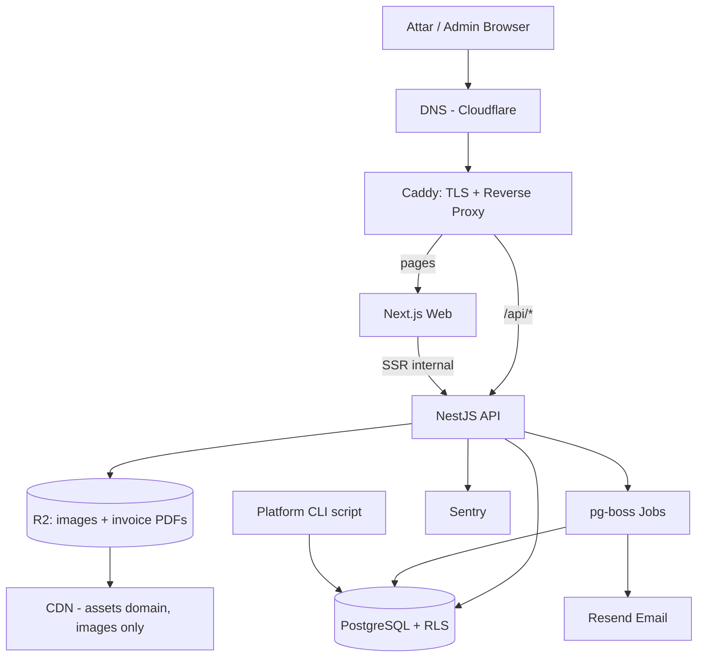
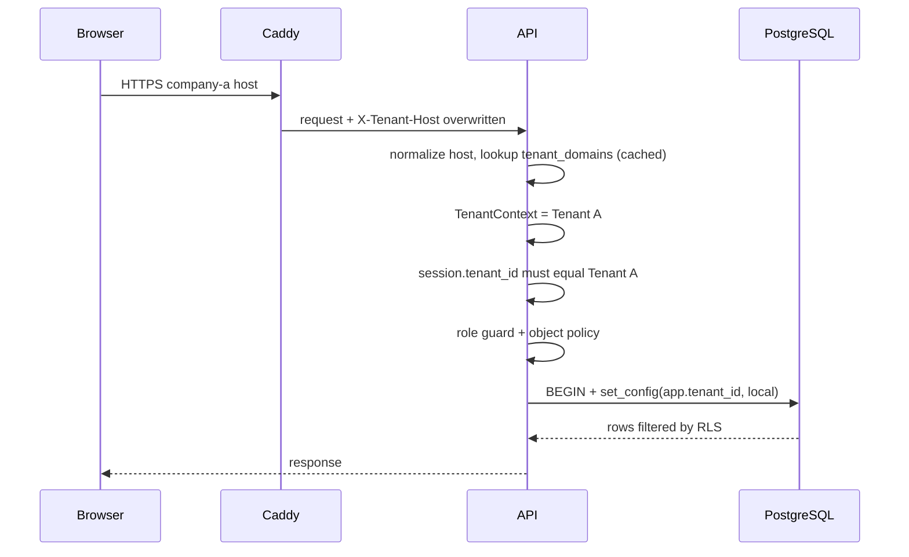
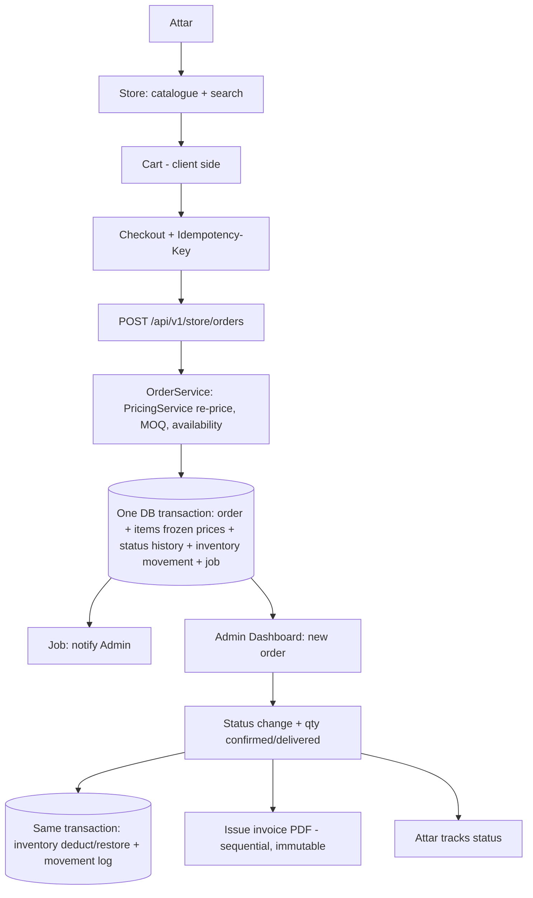
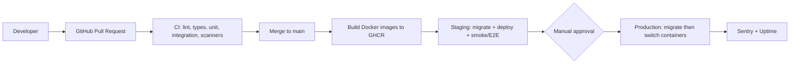
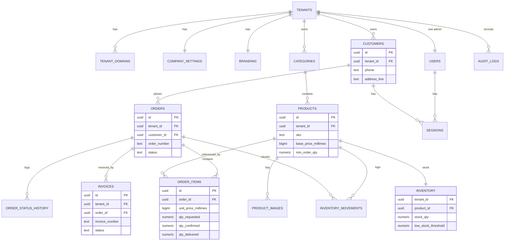

# Technical Blueprint: Jomla Go (B2B White-label Multi-Tenant)

> **الحالة:** v1.1، أكتوبر 2026 (يحل محل v1.0)
> **النطاق:** Distributor → Attar فقط. لا مصانع، لا Marketplace.
> **أولوية المراجع:** `docs/product.md` (نطاق MVP v2) يغلب هذا الملف عند أي تعارض. وإن تعارض طلب مع الـBrief يُسأل المؤسس قبل التنفيذ.
>
> **الفرضيات:**
> - **Fact:** أسعار DigitalOcean في القسم 19 تحققت منها من مصادر منشورة في 2026.
> - **Assumption:** باقي الأرقام تقديرية وتحتاج Validation.
> - **Assumption:** المطوّر يتقن TypeScript (G3).

---

## Changes since v1.0

| # | التغيير | الأثر على التصميم |
|---|---|---|
| 1 | **3 أدوار فقط:** Platform Admin (CLI فقط)، Admin (حساب واحد لكل شركة، بريد)، Attar (هاتف + كلمة مرور). لا Owner/Employee/Manager | حُذف جدول `tenant_users`، ومسار `/dashboard/staff`، وواجهة Platform Admin و`/platform/*` و`admin.platform.com`. هوية Admin صارت Tenant-scoped في جدول `users` |
| 2 | **عنوان واحد داخل `customers`** | حُذف جدول `addresses` وAPI العناوين. الطلب يحفظ Snapshot للعنوان |
| 3 | **حُذف الطلب الهاتفي من اللوحة** | حُذف `source = staff_phone` و`POST /dashboard/orders` |
| 4 | **حُذف استيراد العملاء من Excel** | `imports` للمنتجات فقط (انظر Q1) |
| 5 | **المخزون ضمن MVP** | جداول `inventory` و`inventory_movements`، وخصم/استرجاع تلقائي في نفس Transaction تغيير الحالة |
| 6 | **الفواتير ضمن MVP** | جداول `invoices` و`invoice_counters`، PDF لكل طلب، ترقيم متسلسل لكل شركة، ثابتة بعد الإصدار |
| 7 | **خارج النطاق:** دفع إلكتروني، آجل (Credit)، أسعار خاصة، Web Push، مرتجعات | حُذفت حقول `payment_terms`/`credit_*` و`price_lists`/`price_list_items`. يبقى `PricingService` نقطة قراءة السعر الوحيدة |
| 8 | **G1 محسوم:** المحامي أفاد بعدم وجود مشكلة في الاستضافة بالخارج (**Fact** نقلًا عن المؤسس) | يُحفظ التأكيد كتابيًا في `docs/` (انظر G1). الـArchitecture يبقى Portable |
| 9 | **المدة ≈ 30 أسبوعًا** حسب الخطة الحالية بدل 12–14 | القسم 20 أُعيد بناؤه على Sprints الـBrief |
| 10 | Drizzle معتمد؛ اختبارات DB تتصل بـ`app_runtime` | القسم 14 |

---

## فهرس

1. Executive Technical Summary
2. Architecture Decision
3. Final Technology Stack + ADRs
4. Multi-Tenant Strategy
5. System Architecture (+ 4 Diagrams)
6. Database Architecture (+ ERD)
7. Backend Architecture
8. Frontend Architecture
9. Authentication & Authorization
10. Security
11. Infrastructure
12. Custom Domains
13. API Architecture
14. Testing
15. CI/CD + Backup/DR
16. Observability
17. Performance
18. Scalability
19. Cost
20. Implementation Roadmap + Definition of Done
21. Final Blueprint
22. Open Questions + Known Issues

---

## 1. Executive Technical Summary

بمطوّر واحد (15–25 ساعة/أسبوع) وميزانية صغيرة، نبني **Modular Monolith** بـTypeScript: Next.js للواجهات وNestJS للـAPI، فوقهما PostgreSQL واحدة بـ`tenant_id` وحماية **Row-Level Security**. يُنشر الكل بـDocker Compose على خادم واحد، ويُبنى بحيث ينتقل من 10 إلى 1,000 شركة دون إعادة كتابة.

### قرارات مهمة

| القرار | السبب |
|---|---|
| **Custom Auth بجلسات في DB** | العطار يدخل برقم هاتف، وهويته مرتبطة بشركة واحدة. Auth خارجي يعقّد INPDP ويضيف Lock-in |
| **هوية Attar وAdmin كلاهما Tenant-scoped** | الموزعون منافسون، فلا ربط بين حسابات نفس الشخص عبر الشركات |
| **لا جداول roles/permissions الآن** | 3 أدوار ثابتة، والصلاحيات في الكود. تصميم RBAC يبقى مفتوحًا لإضافة أدوار موظفين بعد الـPilot |
| **Platform Admin عبر CLI فقط** | يلغي سطح هجوم كامل (واجهة + MFA + Host إداري) |
| **Next.js ليس لأجل SEO** | Branding من أول Render، وManifest خاص بكل شركة (PWA) |
| **Inventory وInvoices مرتبطان بآلة حالات الطلب** | القاعدة: تغيير الحالة وحركة المخزون يتغيّران معًا دائمًا |
| **ترتيب البناء حسب الخطر** | Tenancy أولًا، ثم Accounts، Catalog، Orders، Inventory، Storefront، Invoices |

### بوابات قرار

- **G1، الاستضافة والقانون: محسوم.** **Fact (نقلًا عن المؤسس):** المحامي أفاد بأن لا مشكلة. **Recommendation:** احفظ التأكيد كتابيًا في `docs/legal/` قبل إدخال بيانات حقيقية. **Assumption:** نقل الاستضافة لتونس يبقى ممكنًا لأن البنية Portable.
- **G2، نطاقات .tn:** هل يتيح المسجّل A/CNAME؟ (Assumption). يؤثر فقط على Custom Domains بعد الـPilot.
- **G3، الخبرة:** تأكيد الارتياح مع TypeScript/NestJS.

---

## 2. Architecture Decision

| المعيار | Monolith | **Modular Monolith** | Microservices |
|---|---|---|---|
| سرعة التطوير | الأعلى | عالية | الأقل |
| التعقيد | ينتهي Spaghetti | منخفض مع انضباط | عالٍ جدًا |
| مطوّر واحد | نعم | **نعم** | لا |
| التكلفة | الأدنى | الأدنى | أعلى |
| التوسع | عمودي | عمودي + أفقي (Stateless) | أفقي مرن |

**القرار: Modular Monolith** بنشرين من نفس الـRepo: `web` (Next.js) و`api` (NestJS، مع Worker للـJobs داخل العملية في البداية).

**منع Spaghetti:** كل Module يعرض Service عامًا واحدًا ولا يقرأ جداول غيره، وتُفرض القاعدة بـ`dependency-cruiser` وESLint في الـCI.

---

## 3. Final Technology Stack

### 3.1 القرارات

| المكوّن | القرار | البدائل ولماذا رُفضت |
|---|---|---|
| **Frontend** | Next.js (App Router) + TypeScript + Tailwind + shadcn/ui + TanStack Query + next-intl | *Vite SPA:* Branding وManifest لكل شركة يحتاجان Server-side |
| **Backend** | NestJS (Fastify) + TypeScript | *Next API Routes:* لا Modules ولا Guards ولا Jobs |
| **Database** | PostgreSQL | *MySQL:* بلا RLS. *MongoDB:* بيانات علائقية |
| **ORM** | **Drizzle** | أقرب للـSQL، يدعم Partial Indexes وComposite FKs وسياسات RLS |
| **Authentication** | Custom Session Auth (argon2id + جلسات في DB) | *Clerk/Supabase/Firebase/Auth.js:* لا يناسب Phone+Password per Tenant أو Lock-in |
| **Authorization** | RBAC في الكود + Policies على الكائن + RLS | القسم 9 |
| **Multi-Tenancy** | Shared DB + Shared Schema + `tenant_id` + RLS | القسم 4 |
| **Queue** | pg-boss | Redis/BullMQ: بنية إضافية بلا حاجة |
| **Search** | PostgreSQL `pg_trgm` + `unaccent` | لا مشكلة بحث بعد |
| **Cache** | لا Redis. LRU في الذاكرة لنطاقات Tenants (60 ثانية) | القسم 17 |
| **Hosting** | DigitalOcean FRA1: Droplet + Managed PostgreSQL | Vercel/AWS/Supabase: تكلفة أو تعقيد أو Lock-in |
| **Proxy / TLS** | Caddy | Nginx+Certbot: لا On-demand TLS سهل |
| **DNS** | Cloudflare DNS (نطاق المنصة) | مطلوب لشهادة Wildcard بـDNS-01 |
| **Object Storage + CDN** | Cloudflare R2 (S3-compatible) | S3: رسوم Egress |
| **Email** | Resend | SES/Brevo بدائل |
| **Notifications MVP** | Email + إشعار داخل اللوحة (Polling كل 20 ثانية) | Web Push **خارج النطاق** |
| **PDF الفواتير** | **مكتبة تُقترح على المؤسس قبل إضافتها** (انظر Q3) | قاعدة الـBrief: لا Dependency بلا موافقة |
| **Monitoring** | Sentry + Better Stack | بدون Prometheus/Grafana |
| **CI/CD** | GitHub Actions → GHCR → SSH Deploy | Kubernetes/ECS ممنوع حاليًا |
| **Testing** | Vitest + Testcontainers + Supertest + Playwright | انظر T-01 في القسم 22 |

**ملاحظات:**
- **Portability:** لا ميزات خاصة بمزوّد، فالنقل إلى خادم في تونس Config وليس إعادة كتابة.
- **المنصة على `.com`:** النطاق الرئيسي مؤقتًا `platform.com` (Placeholder).
- المعرّفات UUIDv7 تُولَّد في التطبيق.

### 3.2 ADRs

#### ADR-001: Architecture Style
- **Status:** Accepted
- **Decision:** Modular Monolith (web + api + Worker داخل العملية).
- **Reason:** أسرع تطوير وأقل تشغيل لمطوّر واحد، مع حدود صريحة تُفرض آليًا.
- **Trade-offs:** يحتاج انضباطًا؛ التوسع الأفقي للتطبيق كله.
- **Migration Path:** فصل Worker بنفس الـImage، ثم استخراج Module ثقيل إن ثبت اختناق. لا Microservices قبل ذلك.

#### ADR-002: Multi-Tenancy Model
- **Status:** Accepted
- **Options:** A: DB لكل Tenant. B: Schema لكل Tenant. C: Shared + `tenant_id`. D: Hybrid.
- **Decision:** C + **RLS (ENABLE + FORCE)** + Composite FKs، مع طريق مفتوح نحو D.
- **Reason:** أقل تكلفة، Migration واحد، وRLS تحوّل العزل إلى ضمانة DB. كل وصول عبر `TenantDb`، وكل Index يبدأ بـ`tenant_id`.
- **Trade-offs:** خطأ تهيئة RLS قد يكسر العزل بصمت (لذلك Scanners في CI)؛ استعادة Tenant منفرد أصعب؛ Noisy neighbor ممكن.
- **Migration Path:** نقل Tenant كبير لـDB خاصة، ثم Partitioning بـHash على `tenant_id`.

#### ADR-003: Database
- **Status:** Accepted
- **Decision:** PostgreSQL (Managed).
- **Reason:** RLS أصلي، Composite FKs، Partial Indexes، `pg_trgm`، ACID كاملة.
- **Trade-offs:** Managed على DO بلا Superuser ولا `BYPASSRLS`، فنصمم أدوارًا بسياسات صريحة.
- **Migration Path:** رفع الحجم، Standby، Read Replica للتقارير، Partitioning.

#### ADR-004: Backend
- **Status:** Accepted
- **Decision:** NestJS (Fastify) + Zod من حزمة `contracts` مشتركة.
- **Reason:** Modules وGuards وDI، ولغة واحدة مع الـFrontend، وOpenAPI تلقائي.
- **Trade-offs:** منحنى تعلم؛ يعتمد على G3.

#### ADR-005: Frontend
- **Status:** Accepted
- **Decision:** تطبيق Next.js واحد بـRoute Groups، تصنيف الـHost في `middleware`، `standalone` بلا ميزات Vercel.
- **Reason:** Branding واتجاه RTL وManifest ديناميكي من أول Render.
- **Trade-offs:** نفس الـOrigin للعطار والـAdmin (نخففه بكوكيات منفصلة وCSP صارم)؛ خطر Cache عبر Tenants (صفحات Dynamic + E2E).

#### ADR-006: Authentication
- **Status:** Accepted
- **Decision:** Custom Session Auth: Token عشوائي 256-bit في كوكي `__Host-`، Hash فقط في `sessions`، `argon2id`، **Realmان: `attar` و`admin`**. Platform Admin بلا Login (CLI).
- **Reason:** يدعم Phone+Password وهوية Tenant-scoped وRevocation فوري بلا تكلفة MAU.
- **Trade-offs:** نتحمل مسؤولية الأمان (نستعمل مكتبات معروفة). إعادة تعيين كلمة مرور العطار يدويًا من الـAdmin حتى يتوفر SMS OTP.
- **Migration Path:** SMS/WhatsApp OTP، MFA للـAdmin، أو مزوّد Identity.

#### ADR-007: Storage
- **Status:** Accepted
- **Decision:** Cloudflare R2 + نطاق Assets، مفاتيح بمحتوى Hash، إعادة ترميز بـ`sharp` إلى WebP بثلاثة أحجام. **تُخزَّن فيه أيضًا ملفات PDF الفواتير** بمفاتيح عشوائية وتُقدَّم عبر API بتحقق صلاحية (ليست عامة).
- **Migration Path:** أي S3-compatible بتغيير Endpoint.

#### ADR-008: Hosting
- **Status:** Accepted. **G1 محسوم** (انظر القسم 1).
- **Decision:** DigitalOcean FRA1: Droplet (Compose + Caddy) + Managed PostgreSQL. Staging ببيانات اصطناعية فقط.
- **Trade-offs:** Single Droplet = نقطة فشل تشغيلية؛ زمن الاستجابة تونس ↔ فرانكفورت (Assumption مقبول).
- **Migration Path:** خادم في تونس بنفس Compose + `pgBackRest` إلى R2.

#### ADR-009: Custom Domains
- **Status:** Accepted، التنفيذ **بعد الـPilot** وخارج MVP v2.
- **Decision:** Wildcard للمنصة من اليوم الأول (DNS-01 على Cloudflare)، وCustom Domains لاحقًا عبر Caddy On-demand TLS مع `ask` endpoint.
- **ملاحظة:** الـBrief يذكر `company-a.tn` كمثال. **Assumption:** في الـPilot يعمل المتجر على نطاق فرعي للمنصة، ويُسأل المؤسس إن كان Custom Domain شرطًا للـPilot (Q5).

---

## 4. Multi-Tenant Strategy

### 4.1 القرار
C (Shared + `tenant_id`) + RLS. التسعير المنخفض يجعل DB أو Schema لكل شركة تقتل الهامش، وRLS تحول خطأ "نسيان WHERE tenant_id" من تسرب إلى نتيجة فارغة.

### 4.2 طبقات العزل (Defense in Depth)

| الطبقة | الآلية |
|---|---|
| **L1** | Tenant يُحدد **server-side فقط** من الـHost، ولا يُقبل `tenant_id` من Body/Query/Header/URL |
| **L2** | `session.tenant_id` يجب أن يساوي Tenant الـHost الحالي |
| **L3** | Guards + **كل وصول للـDB عبر `TenantDb`**. استيراد Pool الخام ممنوع (ESLint) |
| **L4** | **RLS** على كل جدول بـ`tenant_id`، والمستخدم `app_runtime` ليس Owner |
| **L5** | **Composite FKs**: `orders(tenant_id, customer_id) → customers(tenant_id, id)` |
| **L6** | اختبارات آلية + فحص CI أن كل جدول فيه `tenant_id` عليه RLS مفعّلة |

**`TenantDb`:** يفتح Transaction ويضبط `app.tenant_id` (محليًا للـTransaction) من `TenantContext`. إن لم يُضبط تُرجع الاستعلامات صفر صفوف (Fail-closed).

```sql
ALTER TABLE orders ENABLE ROW LEVEL SECURITY;
ALTER TABLE orders FORCE ROW LEVEL SECURITY;
CREATE POLICY tenant_isolation ON orders TO app_runtime
  USING (tenant_id = NULLIF(current_setting('app.tenant_id', true), '')::uuid);
```

**RLS مزدوجة للعطار:** على `orders` و`order_items` و`invoices` سياسة إضافية: عند وجود `app.customer_id` يُسمح بصفوف هذا العطار فقط. تضبطه `TenantDb` من هوية الجلسة وليس الـHandlers.

**الأدوار في DB:**
- `app_owner`: Migrations فقط.
- `app_runtime`: DML فقط، وتسري عليه RLS.
- `app_platform`: لسكربتات CLI والـJobs، بسياسة صريحة `USING (true)` (لا `BYPASSRLS` على Managed DB).

### 4.3 أمثلة Bugs

| Bug | ما يمنعه |
|---|---|
| `GET /orders/:id` بالـID فقط | RLS تُرجع null ثم 404 (وليس 403) |
| `PATCH /products/:id` بـ`tenant_id` في الـBody | Zod `strict()` والـTenant من الـContext |
| Join بلا شرط Tenant | RLS على كل الجداول |
| Next.js Full Route Cache بلا Host | صفحات Dynamic + E2E |
| رابط Reset من `Host` الخام | الرابط من النطاق المسجّل للـTenant |

---

## 5. System Architecture

### 5.1 Request Lifecycle
1. **DNS** يشير إلى الخادم.
2. **Caddy (TLS)** بشهادة Wildcard، ويضع `X-Tenant-Host` بالـHost الفعلي فوق أي قيمة من العميل.
3. **Routing:** `/api/*` إلى NestJS، والباقي إلى Next.js.
4. **Domain Detection:** توحيد الصيغة والبحث في `tenant_domains` (Cache 60 ثانية).
5. **Tenant Resolution:** نطاق مجهول أو Tenant موقوف ← 404 أو صفحة "الخدمة موقوفة".
6. **TenantContext** في AsyncLocalStorage.
7. **Authentication:** كوكي Host-only، والجلسة تطابق Tenant الـContext.
8. **Authorization:** Guard للـRole ثم Policy على الكائن.
9. **Services** ← **`TenantDb`** ← RLS.

الـAPI على شبكة Docker داخلية غير منشورة، وSame-origin (لا CORS).

### 5.2 Diagram 1: High-Level



### 5.3 Diagram 2: Multi-Tenant Request Flow



### 5.4 Diagram 3: Order, Inventory and Invoice Flow



### 5.5 Diagram 4: Deployment



---

## 6. Database Architecture

### 6.1 مبادئ ثابتة
- **PK:** UUIDv7. الحماية هي RLS وليست الـUUID.
- **المال:** `bigint` بالـMillimes (TND = 3 خانات). الكميات `numeric(12,3)`. لا Float أبدًا.
- **كل جدول Tenant-owned:** `tenant_id NOT NULL` وفريد `(tenant_id, id)` للـComposite FKs.
- **Soft delete** (`archived_at`) للمنتجات والعملاء.
- **Snapshots في الطلب:** السعر، اسم المنتج، SKU، الوحدة، `vat_rate`، عنوان التسليم. **الأسعار مجمّدة وقت الطلب.**
- **الصور والـPDF خارج DB:** `object_key` فقط.
- **Timestamps:** `timestamptz`، والعرض بمنطقة `Africa/Tunis`.

### 6.2 جداول المنصة

| الجدول | الغرض | Constraints |
|---|---|---|
| `tenants` | `slug`، `name`، `status` (trial/active/suspended/archived)، `default_locale` | `slug` فريد |
| `tenant_domains` | `tenant_id`، `hostname`، `kind` (platform/custom)، `is_primary`، `verification_status` | `hostname` فريد (citext)، دومين رئيسي واحد لكل Tenant |
| `audit_logs` | `tenant_id` (قد يكون Null)، `actor_type/id`، `action`، `entity_type/id`، `diff` (jsonb) | Append-only، Index `(tenant_id, created_at desc)` |

### 6.3 جداول Tenant-owned (كلها عليها RLS)

| الجدول | الحقول المهمة | Constraints |
|---|---|---|
| `users` (Admin) | `email` (citext)، `password_hash`، `name`، `status` | فريد `(tenant_id, email)`؛ **Partial Unique: Admin واحد لكل Tenant** |
| `sessions` | `token_hash` (SHA-256)، `realm` (admin/attar)، `user_id` أو `customer_id`، `expires_at`، `last_seen_at` | `token_hash` فريد |
| `auth_tokens` | `type`، `token_hash`، `expires_at`، `used_at` | مرة واحدة، صلاحية قصيرة |
| `company_settings` | هاتف/واتساب، `min_order_amount`، `order_cutoff_time`، `prices_include_vat`، بريد الإشعارات، بيانات الفاتورة (اسم قانوني، عنوان، رقم تعريف جبائي) | PK = `tenant_id` |
| `branding` | `logo_key`، `primary_color`، عنوان المتجر، رسالة ترحيب | PK = `tenant_id` |
| `customers` | `code`، `business_name`، `contact_name`، `phone` (E.164)، `password_hash`، `status` (active/suspended)، **العنوان داخل الصف:** `address_line`، `city`، `governorate`، `notes`، `last_order_at` | فريد `(tenant_id, phone)` و`(tenant_id, code)` |
| `categories` | `name`، `name_ar`، `parent_id` (مستوى واحد)، `sort_order`، `is_active` | Index `(tenant_id, parent_id, sort_order)` |
| `products` | `sku`، `name`، `name_ar`، `category_id`، `unit`، `base_price_millimes`، `vat_rate`، `min_order_qty`، `order_step`، `availability` (available/out_of_stock/hidden)، `barcode`، `brand`، `archived_at` | فريد `(tenant_id, sku)`؛ GIN Trigram؛ CHECK `base_price >= 0` |
| `product_images` | `object_key`، `width/height`، `sort_order` (صورة واحدة) | Composite FK |
| `inventory` | PK `(tenant_id, product_id)`، `stock_qty`، `low_stock_threshold` | CHECK `stock_qty >= 0` (انظر Q2) |
| `inventory_movements` | `product_id`، `type` (order_deduct/order_restore/manual_adjust)، `qty_delta`، `qty_after`، `order_id` (Null للتعديل اليدوي)، `reason` (إلزامي للتعديل اليدوي)، `created_by`، `created_at` | **Append-only**، Index `(tenant_id, product_id, created_at desc)` |
| `orders` | `order_number` (`CMD-000123` متسلسل لكل Tenant)، `customer_id`، `status`، `created_by_type/id`، عنوان التسليم (Snapshot)، `requested_delivery_date`، `customer_note`، `internal_note`، `total_ordered/confirmed/delivered_millimes`، `client_request_id`، `status_changed_at` | فريد `(tenant_id, order_number)` و`(tenant_id, client_request_id)` |
| `order_items` | Snapshots: `product_name`، `sku`، `unit`، **`unit_price_millimes`**، `vat_rate`؛ و`qty_requested`، `qty_confirmed` (Null حتى التأكيد)، `qty_delivered` (Null حتى التسليم) | CHECK `qty_requested > 0`؛ Composite FK |
| `order_status_history` | `from_status`، `to_status`، `changed_by_type/id`، `note`، `reason_code`، `created_at` | **Append-only** |
| `order_counters` | عدّاد الترقيم لكل Tenant (يُحدَّث في نفس Transaction الطلب) | PK = `tenant_id` |
| `invoices` | `invoice_number` (متسلسل لكل Tenant)، `order_id`، `status` (issued/cancelled)، **Snapshot كامل** (بيانات الشركة والعطار، البنود، المجاميع، TVA) في `snapshot` jsonb، `pdf_key`، `issued_at`، `cancelled_at`، `cancel_reason`، `cancelled_by`، `replaced_by_invoice_id` | فريد `(tenant_id, invoice_number)`؛ **ثابتة:** لا UPDATE إلا على أعمدة الإلغاء (انظر 6.5) |
| `invoice_counters` | عدّاد ترقيم الفواتير لكل Tenant (نفس نمط `order_counters`، داخل Transaction الإصدار) | PK = `tenant_id` |
| `import_jobs` | استيراد Excel للمنتجات: `status`، `file_key`، `report` | (انظر Q1) |

**لماذا الكميات الثلاث؟** عند التأكيد قد ينقص مخزون صنف، فيعدّل الـAdmin الكمية ويراها العطار قبل التسليم، وتبقى الكمية الأصلية محفوظة.

### 6.4 ما أُجِّل أو حُذف

| العنصر | القرار |
|---|---|
| Customer/Special prices، `price_lists` | **خارج MVP** (Post-pilot candidate). لا جداول الآن. `PricingService` يقرأ السعر الأساسي اليوم، وهو نقطة التوسعة لاحقًا |
| Payment terms / Credit | **خارج MVP** |
| دفع إلكتروني، مرتجعات، Web Push، GPS، Marketplace | **خارج MVP** |
| `addresses`، `tenant_users`، الطلب الهاتفي، استيراد العملاء | **حُذفت** |
| Delivery zones، Customer-specific Catalogue، Ledger | Later |
| TVA | `vat_rate` + Snapshot الآن. **Hypothesis:** هل تُعرض الأسعار HT أم TTC؟ يُسأل في المقابلات |

### 6.5 Order Lifecycle والمخزون والفواتير

```
PENDING → CONFIRMED → PREPARING → SHIPPED → DELIVERED
   ↘          ↘           ↘          ↘
                 CANCELLED (+ reason_code)
```

- **القفز مسموح** (PENDING → SHIPPED) والواجهة تعرض "إجراءات سريعة".
- **الرجوع للخلف:** Admin فقط مع ملاحظة إلزامية، ويُسجل في History.
- **الإلغاء:** العطار وهو PENDING فقط؛ الـAdmin حتى SHIPPED.
- **التزامن:** Compare-and-swap (`UPDATE ... WHERE status = :from`) داخل نفس Transaction إدراج History.
- **قاعدة ثابتة:** أي تغيير حالة يُؤثر على المخزون يتم **في نفس Transaction** مع كتابة `inventory_movements`. يمر عبر `InventoryService` فقط، ولا يعدّل أي Module آخر `inventory`.
- **الخصم/الاسترجاع:** تلقائي حسب الحالة. **توقيت الخصم (عند الإنشاء أم التأكيد؟) غير محسوم** (Q2). الإلغاء يسترجع ما خُصم، وكل حركة تُسجَّل.
- **التعديل اليدوي:** سبب إلزامي، ويُسجَّل في `inventory_movements` و`audit_logs`.
- **تنبيه المخزون المنخفض:** عندما `stock_qty <= low_stock_threshold` (إشعار داخل اللوحة).
- **الفاتورة:** تُصدر لكل طلب بنقرة من الـAdmin، داخل Transaction تزيد `invoice_counters` وتكتب `snapshot`، ثم Job يولّد الـPDF ويرفعه إلى R2. **بعد الإصدار** يمنع Trigger أي UPDATE/DELETE خارج أعمدة الإلغاء. **الإلغاء:** Admin فقط، سبب إلزامي، ثم تُصدر فاتورة جديدة برقم جديد وتُربط عبر `replaced_by_invoice_id`. **Assumption:** متطلبات الترقيم والبيانات الإلزامية للفاتورة التونسية يؤكدها محاسب/محامٍ قبل الـPilot (Q4).

### 6.6 Mermaid ERD



---

## 7. Backend Architecture

### 7.1 Modules

| Module | المسؤولية | يملك جداول | يعتمد على |
|---|---|---|---|
| `tenancy` | Tenants، Domains، Resolution، Context | `tenants`، `tenant_domains` | |
| `auth` | Sessions، Login (Admin/Attar)، Password reset | `users`، `sessions`، `auth_tokens` | `tenancy` |
| `customers` | العطارون، الحالات، العنوان | `customers` | `auth` |
| `catalog` | المنتجات، التصنيفات، الصور، **PricingService** | `products`، `categories`، `product_images` | `storage` |
| `inventory` | المخزون، الحركات، التنبيهات، **InventoryService** | `inventory`، `inventory_movements` | `catalog` |
| `orders` | إنشاء الطلب، الكميات الثلاث، الحالات، الترقيم، History | `orders`، `order_items`، `order_status_history`، `order_counters` | `catalog` (Pricing)، `customers`، `inventory` |
| `invoices` | الإصدار، الترقيم، PDF، الإلغاء | `invoices`، `invoice_counters` | `orders`، `settings`، `storage` |
| `imports` | استيراد منتجات (Q1) | `import_jobs` | `catalog` |
| `settings` | إعدادات الشركة وBranding | `company_settings`، `branding` | `storage` |
| `notifications` | البريد وإشعارات اللوحة (Jobs) | | يستمع لأحداث `orders`/`inventory` |
| `reporting` | إحصاءات (قراءة فقط) | | يقرأ Views |
| `platform-cli` | سكربتات: إنشاء شركة + Admin، تعليق/تفعيل | | `tenancy`, `auth` |
| `audit` | الأحداث الحساسة | `audit_logs` | |
| `storage`, `health` | R2، Liveness/Readiness | | |

**قواعد التواصل:**
1. بين Modules عبر Services العامة فقط (`orders` يستدعي `PricingService` و`InventoryService`).
2. أحداث داخلية (`OrderPlaced`، `OrderStatusChanged`، `LowStock`) تتحول إلى Jobs في pg-boss ضمن نفس Transaction (Outbox).
3. ممنوع Import دائري، ويُفحص آليًا.
4. `reporting` وحده يقرأ جداول غيره، بصلاحية قراءة فقط.

**Pipeline كل Request:** Request-ID → توحيد Host → Tenant Resolution → Auth → Guard → Validation (Zod) → Handler → Service → `TenantDb`.

**نقطتا الوصول للـDB:** `TenantDb` (الافتراضي) و`PlatformDb` (دور `app_platform`، مسموح في `tenancy`، `auth`، `platform-cli`، `jobs` فقط، يُفرض بـLint).

### 7.2 Folder Structure (pnpm workspaces)

```
repo/
├─ apps/
│  ├─ web/                          # Next.js
│  │  ├─ app/
│  │  │  ├─ (store)/                # متجر العطار
│  │  │  ├─ (dashboard)/dashboard/  # لوحة الـAdmin
│  │  │  ├─ manifest.webmanifest/   # Manifest حسب الـHost
│  │  │  └─ api/health/
│  │  ├─ features/ components/ui/ lib/ tenant/ auth/ hooks/
│  │  ├─ messages/ (ar.json, fr.json)
│  │  └─ middleware.ts
│  └─ api/                          # NestJS
│     └─ src/
│        ├─ common/ infra/ (db, storage, mail, jobs, config)
│        ├─ tenancy/ auth/
│        ├─ modules/ (catalog, inventory, orders, invoices, customers,
│        │            settings, imports, notifications, reporting, audit)
│        ├─ cli/                    # platform scripts
│        └─ permissions/ (roles.ts, permissions.ts, policies/)
├─ packages/ (contracts, db, config)
├─ infra/    # compose, Caddyfile, scripts
└─ docs/     # product.md, TECHNICAL_BLUEPRINT.md, ADRs, runbooks, legal/
```

كل Module: `controllers → services → repositories → dto`، والـRepository هو الوحيد الذي يمس `TenantDb`.

---

## 8. Frontend Architecture

**تطبيق Next.js واحد** مع تصنيف الـHost في `middleware`:

| المسار | يعرض | ملاحظات |
|---|---|---|
| `company-a.platform.com/` | المتجر `(store)` | Attar فقط |
| `company-a.platform.com/dashboard` | لوحة الـAdmin | نفس الـHost، وكوكي مختلف |

**الثمن:** نفس الـOrigin للعطار والـAdmin، فنخفف بكوكيات منفصلة لكل Realm، وCSP صارم بـNonce، ومنع HTML من المستخدمين.

**قواعد العرض:**
- Server Components للـShell (Branding، لغة، RTL)، وClient Components لـCatalogue والسلة (TanStack Query).
- **كل صفحات المتجر Dynamic** (لا Full Route Cache) حتى لا يتسرب Cache بين Tenants.
- **PWA:** Manifest ديناميكي لكل شركة، وService Worker بسيط لـAssets وصفحة Offline. لا تخزين Offline للطلبات.
- السلة Client-side (LocalStorage بحسب الـOrigin)، والسعر النهائي يُحسب في الـServer.
- **i18n:** العربية (RTL) والفرنسية، ولغة افتراضية لكل Tenant. العملة TND بثلاث خانات.
- **حالة التوفر:** المتجر يعرض available/out_of_stock من المخزون والـ`availability`.
- **للشبكات الضعيفة:** WebP بثلاثة أحجام، Lazy loading، Pagination، Debounce، Retry مع Idempotency-Key.
- Next.js Self-hosted (`standalone`) بلا ميزات Vercel.

---

## 9. Authentication & Authorization

### 9.1 Realms

| Realm | المستخدم | المعرّف | التخزين | Cookie |
|---|---|---|---|---|
| `attar` | العطار | هاتف + كلمة مرور | `customers` | `__Host-store` |
| `admin` | الموزع | بريد + كلمة مرور | `users` (Tenant-scoped) | `__Host-admin` |

**Platform Admin:** لا Realm ولا Login. يعمل عبر CLI على الخادم بدور `app_platform`، وحمايته هي التحكم في الوصول للخادم والأسرار.

### 9.2 التصميم
- **Session:** Token عشوائي 256-bit، كوكي `HttpOnly; Secure; SameSite=Lax; Path=/` بالبادئة `__Host-`، ونخزّن Hash فقط. Revocation فوري.
- **Password:** `argon2id`، حد أدنى للطول، فحص كلمات شائعة.
- **مدد الجلسات (Assumptions):** Attar: 30 يومًا منزلقة. Admin: 8 ساعات خمول و14 يومًا مطلقة.
- **حساب العطار:** ينشئه الـAdmin ويرسل رابط التفعيل (واتساب يدويًا)؛ إعادة التعيين يبدؤها الـAdmin. SMS OTP لاحقًا.
- **حساب الـAdmin:** يُنشأ بسكربت CLI مع الشركة؛ Reset بالبريد (Token مرة واحدة، 30 دقيقة).
- **Brute Force:** Rate Limit لكل IP ولكل معرّف مع تأخير متصاعد (لا قفل نهائي).
- **CSRF:** `SameSite=Lax` + فحص `Origin` + Same-origin API.

### 9.3 RBAC (MVP: 3 أدوار)

| الصلاحية | Platform Admin (CLI) | Admin | Attar |
|---|---|---|---|
| إنشاء/تعليق/تفعيل شركات وإنشاء Admin | ✓ | ✗ | ✗ |
| الإعدادات، Branding | ✗ | ✓ | ✗ |
| المنتجات والتصنيفات والصور | ✗ | ✓ | ✗ |
| العملاء: إنشاء/تعليق/إعادة تعيين كلمة المرور | ✗ | ✓ | ✗ |
| الطلبات: عرض الكل، تغيير الحالة، تعديل الكميات | ✗ | ✓ | **طلباته فقط** |
| إنشاء طلب وإعادة الطلب | ✗ | ✗ | ✓ |
| إلغاء طلب | ✗ | حتى SHIPPED | PENDING فقط |
| المخزون: تعديل يدوي وعرض الحركات | ✗ | ✓ | ✗ |
| الفواتير: إصدار/عرض/إلغاء بسبب | ✗ | ✓ | عرض فواتير طلباته (Assumption، Q6) |
| الإحصاءات وسجل التدقيق | ✗ | ✓ | ✗ |

**تصميم مفتوح للمستقبل:** تُعرَّف الصلاحيات كثوابت (`permissions.ts`) تُربط بالأدوار (`roles.ts`)، فإضافة دور موظف لاحقًا تعني إضافة صف في الخريطة وجدول عضويات عند الحاجة. **لا نبني اليوم** دعوة موظفين ولا إدارة أدوار.

### 9.4 أين تُطبَّق الصلاحيات؟
**Backend (Guards + Policies)** هو المرجع. **RLS** حاجز أخير (Tenant + ملكية العطار). **Frontend** إخفاء أزرار فقط.

كل Route يحمل Decorator صريحًا: `@Public` أو `@Attar` أو `@Admin(permission)`. Route بلا تصنيف يُفشل اختبار الـCI.

---

## 10. Security

**Cross-Tenant Leakage هو الخطر الأول.**

| Threat | Mitigation | Test |
|---|---|---|
| IDOR / Cross-tenant | L1–L6 | مصفوفة Cross-tenant آلية |
| Host Header Injection | الروابط من نطاقات الـTenant المسجلة | Reset مع Host مزوّر |
| Cache Poisoning عبر Tenants | Dynamic فقط، `no-store` للصفحات الخاصة | E2E بنفس المسار على Hosts مختلفة |
| Brute Force / Credential Stuffing | Rate Limit + تأخير + كلمات شائعة | اختبار حدود المعدل |
| Session Hijack | `HttpOnly/Secure/__Host-`، HSTS، Revocation | |
| XSS | React Escaping، CSP بـNonce، لا SVG مرفوع | Payloads في كل الحقول |
| CSRF | `SameSite=Lax` + Origin + Same-origin | Origin غريب ← 403 |
| SQL Injection | معاملات Drizzle، منع SQL نصي (Lint) | SQLi payloads |
| File Upload | حد الحجم، Magic bytes، إعادة ترميز `sharp`، PNG/JPG/WebP فقط | ملف PHP/SVG بامتداد صورة ← يُرفض |
| Excel/CSV Injection | تحييد الخلايا التي تبدأ بـ`=` وحد الصفوف | |
| التلاعب بالطلب | السعر من الـServer، فحص MOQ والتوفر، Strict schema، Idempotency | |
| Race Conditions | `client_request_id` فريد + CAS للحالات + قفل صف المخزون (`SELECT ... FOR UPDATE`) | طلبان متزامنان على آخر وحدة ← واحد ينجح |
| **تلاعب بالفواتير** | Trigger يمنع UPDATE/DELETE بعد الإصدار، الترقيم داخل Transaction، PDF بمفتاح عشوائي وتقديم بتحقق صلاحية | محاولة UPDATE على فاتورة ← فشل |
| Secrets | gitleaks، متغيرات بيئة مقيّدة، مفاتيح لكل بيئة | |
| **وصول CLI/الخادم** | SSH بمفاتيح فقط، لا حسابات مشتركة، سجل تشغيل السكربتات في `audit_logs` | |
| Backups | تشفير النسخ الخارجية (age)، استعادة شهرية | |
| سجلات تحتوي PII | `sendDefaultPii=false` وقناع للهواتف والبريد | اختبار قناع السجلات |

**عام:** HTTPS فقط (HSTS)، ترويسات أمان، `npm audit` وDependabot، ومنفذا 80/443 فقط للخارج.

---

## 11. Infrastructure

**القرار:** DigitalOcean FRA1 (G1 محسوم). البديل عند الحاجة: خادم في تونس بنفس Compose.

| المكوّن | الحل |
|---|---|
| Production App | Droplet (2 vCPU / 4 GB): Caddy + web + api (+ worker) بـCompose |
| Database | Managed PostgreSQL (1 GiB ثم يُرفع بالقياس)، نسخ يومي |
| Staging | Droplet صغير + PostgreSQL في Container، **بيانات اصطناعية فقط** |
| Storage + CDN | Cloudflare R2 (صور عامة عبر CDN، وPDF خاصة) |
| DNS / Email / Monitoring | Cloudflare / Resend / Sentry + Better Stack |

لا Load Balancer، لا Kubernetes، لا Redis.

| | Development | Staging | Production |
|---|---|---|---|
| DB | Postgres Docker محلي | Container (اصطناعية) | Managed |
| النطاقات | `*.localhost` | `*.staging.platform.com` | `*.platform.com` |
| Email | Mailpit | Allowlist | Resend |
| Secrets | `.env` غير مُلتزَم | GitHub Environment Secrets | + موافقة |

**قاعدة:** لا تُنسخ بيانات Production إلى Staging أو Development أبدًا.

---

## 12. Custom Domains (بعد الـPilot، خارج MVP v2)

نفس تصميم v1.0 مع تعديل واحد: إدارة النطاقات من CLI أو من لوحة الـAdmin (Q5)، لا من Platform UI.

1. الموزع يسجّل النطاق (G2).
2. إضافة النطاق ← حالة `pending` مع Token تحقق.
3. تعليمات DNS: سجل A (أو CNAME لـ`www`) + TXT للتحقق.
4. Job يفحص DNS حتى 72 ساعة ← `verified`.
5. **Caddy On-demand TLS** مع `ask` endpoint يرد 200 فقط للنطاقات المتحقَّق منها.
6. 301 من النطاق الفرعي للمنصة إلى الـCustom. عند الحذف يرفض `ask` فلا تجديد (منع Takeover).

**قيود:** Caddy واحد = نقطة فشل؛ الجذر يحتاج IP ثابتًا؛ بريد الشركة من نطاقها خارج النطاق.

---

## 13. API Architecture

**Base:** `/api/v1`. التقسيم حسب الجمهور (Audience).

| Namespace | Endpoints (أمثلة) |
|---|---|
| `/auth/*` | `POST /auth/admin/login`، `POST /auth/store/login`، `POST /auth/logout`، `POST /auth/password/forgot`، `POST /auth/password/reset` |
| `/store/*` (Attar) | `GET /store/products`، `GET /store/products/:id`، `GET /store/categories`، `POST /store/orders`، `GET /store/orders`، `GET /store/orders/:id`، `POST /store/orders/:id/cancel`، `POST /store/orders/:id/reorder`، `GET /store/me` |
| `/dashboard/*` (Admin) | `/dashboard/products` (CRUD)، `/dashboard/categories`، `/dashboard/customers` (+ `POST /:id/suspend\|activate\|reset-password`)، `/dashboard/orders` (+ `PATCH /:id/status`، `PATCH /:id/items`)، `/dashboard/inventory` (+ `POST /:productId/adjust`، `GET /movements`، `GET /low-stock`)، `/dashboard/invoices` (+ `POST /orders/:id/invoice`، `GET /:id/pdf`، `POST /:id/cancel` بـ`reason`)، `/dashboard/settings`، `/dashboard/branding`، `/dashboard/stats` |
| `/internal/*` | `GET /internal/domains/allow` (لـCaddy، شبكة داخلية، بعد الـPilot) |

**لا `/platform/*`:** عمليات المنصة CLI فقط.

| البند | القرار |
|---|---|
| Tenant Context | من الـHost فقط، لا `tenantId` في URL أو Body |
| Methods | GET قراءة، POST إنشاء/إجراءات، PATCH تعديل جزئي، DELETE أرشفة منطقية |
| Status Codes | 200/201/204، 400، 401، 403، 404 (غير موجود/غير مرئي)، 409 تعارض، 422 قواعد أعمال، 429 |
| Validation | Zod `strict()` من `contracts` |
| الأخطاء | `application/problem+json` (RFC 9457) مع `code` ثابت |
| Pagination | Cursor-based افتراضيًا (حد أقصى 100) |
| Rate Limiting | Login: 5/دقيقة لكل IP+معرّف. عام: ~120/دقيقة. إنشاء طلب: 10/دقيقة. رفع: 20/دقيقة |
| Idempotency | `Idempotency-Key` إلزامي على `POST /store/orders` |
| Versioning / Docs | `/v1` وإضافات فقط؛ OpenAPI تلقائي |

---

## 14. Testing

| المستوى | الأدوات | ماذا نغطي |
|---|---|---|
| Unit | Vitest | `PricingService`، آلة الحالات، المجاميع، الهاتف (+216)، MOQ، منطق المخزون، ترقيم الفواتير |
| Integration | Vitest + Testcontainers | Repositories وRLS. **الاتصال بمستخدم `app_runtime` وليس Owner**، وإلا تتجاوز الاختبارات RLS فتعطي نجاحًا كاذبًا |
| API | Supertest | كل Endpoint: Auth، Validation، Pagination، الأخطاء |
| E2E | Playwright (Viewport هاتف) | عطار يطلب 20 صنفًا؛ الـAdmin يؤكد ويشحن ويصدر فاتورة |
| Security | ZAP Baseline (ليليًا)، gitleaks، `npm audit` | |

### اختبارات حرجة (تفشل عند أي خرق)
1. Admin Tenant A يطلب منتجًا/طلبًا/عميلًا/فاتورة من B ← **404**.
2. عطار A1 يطلب طلب A2 (نفس الشركة) ← **404** (RLS المزدوجة).
3. إرسال `tenant_id` أو `customer_id` في Body ← يُتجاهل أو يُرفض.
4. جلسة Tenant A على Host B ← **401**.
5. عطار يستدعي `/dashboard/*` ← **403**.
6. Tenant موقوف ← لا Login ولا طلبات.
7. طلب بمنتج من Tenant آخر ← فشل (Composite FK + RLS).
8. تعديل `unit_price` من العميل ← يُتجاهل.
9. **Route Scanner:** أي Route بلا تصنيف أمني ← فشل.
10. **RLS Scanner:** كل جدول فيه `tenant_id` عليه RLS + FORCE + سياسة.
11. **Cache E2E:** `/` على Host A ثم B بنفس الجلسة، دون ظهور بيانات A.
12. Rate limit: 6 محاولات Login ← حظر مؤقت.
13. Idempotency: طلبان متزامنان بنفس المفتاح ← طلب واحد.
14. UPDATE/DELETE على `order_status_history` أو `inventory_movements` ← فشل.
15. **تغيير الحالة وحركة المخزون ذرّيان:** فشل أحدهما يُلغي الآخر.
16. طلبان متزامنان على آخر وحدة مخزون ← أحدهما فقط ينجح، ولا يصبح المخزون سالبًا.
17. إلغاء طلب ← استرجاع المخزون بحركة مسجّلة.
18. **الفواتير:** UPDATE/DELETE على فاتورة صادرة ← فشل؛ إصدار متزامن لفاتورتين ← أرقام متسلسلة بلا تكرار أو فجوة؛ إلغاء بلا سبب ← 422.
19. Admin ثانٍ لنفس الشركة ← يفشل (Unique).

---

## 15. CI/CD

**Branching:** Trunk-based: فروع قصيرة ← PR ← `main`. لا دمج بلا CI أخضر. قالب PR بقائمة أمنية (Route جديد؟ مُصنَّف؟ جدول جديد؟ RLS مفعّلة؟).

**CI عند كل PR:** Lint (+ حدود Modules) ← Typecheck ← Unit ← Integration ← فحص Migrations ← gitleaks + audit ← Build.

**CD:** `main` ← Images إلى GHCR بوسم `sha` ← Staging (Migrations + Smoke + E2E) ← موافقة يدوية ← Production. Migrations بنمط Expand/Contract، وRollback = إعادة نشر Image سابقة. النشر خارج ساعات الذروة (Assumption).

**Migrations:** SQL مُراجَع، مع `lock_timeout` و`statement_timeout`، وIndexes بـ`CONCURRENTLY`.

### Backup / DR

| البند | القرار |
|---|---|
| يومي | من Managed PostgreSQL |
| PITR | **يجب التحقق من توفره وفترته** (Assumption) |
| نسخة خارجية | `pg_dump` ليلي مشفّر (age) إلى R2 |
| RPO / RTO | RPO ≤ 15 دقيقة إن توفر PITR وإلا 24 ساعة؛ RTO ≤ 4 ساعات |
| اختبار الاستعادة | شهريًا |
| فقد الخادم | إعادة بناء من Compose + GHCR + الأسرار (< ساعة) |
| Retention | جلسات 30 يومًا؛ Audit سنتان؛ سجلات 30 يومًا؛ **الطلبات والفواتير: مدة قانونية تؤكدها محاسب/محامٍ (Assumption: 10 سنوات)**؛ Tenant محذوف: 90 يومًا ثم Purge |

---

## 16. Observability

| الهدف | الآلية |
|---|---|
| Logging | Pino JSON إلى stdout بحقول `request_id`، `tenant_id`، `actor_type`، `route`، `latency`، مع PII مُقنَّعة، وشحن إلى Better Stack |
| Errors | Sentry للـweb والـapi مع وسم `tenant_id`، `sendDefaultPii=false` |
| Uptime | Better Stack: المتجر، `/api/health/ready`، اللوحة |
| Metrics | مقاييس DO و`pg_stat_statements` |
| Alerts | 5xx فوق 1%؛ p95 فوق 800ms؛ اتصالات DB فوق 80%؛ القرص؛ فشل Backup؛ فشل شهادة؛ Queue متأخر؛ ارتفاع فشل Login؛ **طلب أُنشئ ولم يصل إشعاره**؛ **فشل توليد PDF فاتورة**؛ **مخزون سالب أو فرق بين `inventory` ومجموع الحركات**؛ شركة نشطة بلا طلبات لساعات غير معتادة |
| Audit | تغيير حالة، تعديل مخزون يدوي، إصدار/إلغاء فاتورة، تعليق عميل، تشغيل سكربتات CLI |

**مقاييس الـPilot** (من الـBrief): نسبة الطلبات الأونلاين، زمن الطلب، الأخطاء، دقة المخزون، تكرار تحديث الكتالوج. تُجمع من `orders` و`inventory_movements` و`audit_logs` عبر `reporting`.

---

## 17. Performance

**من البداية:** Indexes تبدأ بـ`tenant_id`؛ Pagination في كل قائمة؛ صور WebP بثلاثة أحجام؛ ضغط Brotli/Gzip؛ إنشاء الطلب في Transaction واحدة بلا N+1 (جلب الأسعار والمخزون دفعة واحدة وقفل صفوف المخزون بترتيب ثابت لتجنب Deadlocks)؛ توليد PDF في Job وليس داخل Request.

**مؤجل:** Snapshot الكتالوج على جهاز العطار، Caching للـSSR، Read Replicas.

- **Redis: لا.** ما نخزنه (Cache النطاقات، Rate Limit) يكفيه ذاكرة العملية. متى نحتاجه: عند أكثر من نسخة API.
- **Queue: pg-boss** للبريد، توليد PDF، تنظيف الجلسات، تنبيهات المخزون، الملخص اليومي. (pg-boss يتصل مباشرة بـDB وليس عبر PgBouncer.)
- **Search: PostgreSQL فقط.** الانتقال لـMeilisearch إن تجاوز p95 للبحث 200ms بعد ضبط Indexes أو ثبتت الحاجة لـTypo-tolerance.

---

## 18. Scalability

*(افتراض الحمل: ≈30 عطارًا نشطًا لكل شركة، 8 طلبات للعطار شهريًا، 20 صنفًا للطلب ≈ 240 طلبًا/شركة/شهر. تقديرية وتحتاج Validation. حجم السوق التونسي للموزعين قد يكون بالمئات إلى الآلاف القليلة، فالتخطيط بعد 1,000 شركة لإبقاء الطريق مفتوحًا فقط.)*

| المرحلة | الحمل | Architecture | DB | Trigger للانتقال |
|---|---|---|---|---|
| **1–10** | ≈ 2,400 طلب/شهر | خادم واحد | DB مُدارة صغيرة | CPU > 70% لمدة 15 دقيقة ← ترقية Droplet |
| **10–100** | ≈ 24k/شهر | خادم أقوى + Worker منفصل | رفع RAM، Slow Queries، PgBouncer | p95 > 500ms أو اتصالات DB > 80% |
| **100–1,000** | ≈ 240k/شهر | 2–4 نسخ API + Load Balancer | Standby + Read Replica للتقارير + **Redis** | أكثر من نسخة API أو تقارير تبطئ التشغيل |
| **1,000+** | ≈ 2.4M/شهر | Autoscaling، Worker منفصل | Partitioning (Hash على `tenant_id`)، نقل الكبار لـDB خاصة | CPU الـDB بعد Replica أو حجم جدول تشغيلي |

الجداول الأسرع نموًا: `orders`، `order_items`، `inventory_movements`، `audit_logs`.

---

## 19. Cost (Infrastructure فقط)

**أسعار تحققت منها (2026، Fact):** Droplet 2 vCPU/4 GB ≈ $24؛ 1 vCPU/2 GB ≈ $12؛ Managed PostgreSQL 1 GiB ≈ $15؛ 4 GiB ≈ $60.90؛ HA من $30 للعقدة مع Standby بالسعر نفسه؛ تخزين إضافي $0.21/GiB؛ Load Balancer ≈ $12.

**من الذاكرة، تحقق قبل الالتزام (Assumption):** Cloudflare R2، Resend، Sentry (~$26 للفريق)، Better Stack. أسعار SMS/WhatsApp في تونس غير معروفة.

| البند ($/شهر، تقريبي) | 10 شركات | 100 شركة | 1,000 شركة |
|---|---|---|---|
| Hosting (App) | 24 + Staging 12 | 48–72 + 12 | 150–250 + LB 12–24 |
| Database | 15 | 61–122 | 200–400 |
| Storage + CDN | ~0–2 | 1–5 | 5–30 |
| Email | 0 | ~20 | 50–200 |
| Monitoring | 0 | 26–55 | 100–250 |
| Backups | ~5 | ~10 | 30–60 |
| **المجموع** | **≈ 55–70** | **≈ 180–300** | **≈ 700–1,500** |
| **لكل شركة** | ≈ 6–7 | ≈ 2–3 | ≈ 0.7–1.5 |

**ملاحظة:** تخزين PDF الفواتير يضيف حجمًا صغيرًا إلى R2 (لم يُقدَّر بدقة). لا يشمل SMS/WhatsApp. لتحويل الدينار: اضرب تقريبيًا في 3 وتحقق من سعر الصرف.

---

## 20. Implementation Roadmap

### 20.1 الترتيب
حسب الخطر والتبعيات، وفق الـBrief. المدة الإجمالية **≈ 30 أسبوعًا** (Fact: الخطة الحالية)، بـSprints من أسبوعين مع Buffer 20–30%. تواريخ Sprint 1: 5–18 أكتوبر 2026.

### 20.2 Sprints و Definition of Done

| # | Sprint | يعتمد على | Done عندما |
|---|---|---|---|
| 1 | **Foundation:** GitHub خاص، CI أخضر، Docker/Postgres، docs، **Blueprint v1.1 (هذا الملف)** | | Push ← CI أخضر؛ `pnpm test` يعمل (T-01) |
| 2 | **Tenancy and isolation:** `tenants`، `tenant_domains`، Resolution، `TenantContext`، `TenantDb`، أدوار DB، RLS، سكربت CLI، Seed لـTenantين | 1 + قرار D5 | تطبيق تجريبي يخدم Tenantين بلا تسرب؛ RLS Scanner أخضر |
| 3 | **Accounts and permissions:** Sessions، Login (Admin/Attar)، Reset، Guards، RBAC، Rate Limits، Audit أساسي | 2 | كل Route مُصنَّف؛ اختبارات 4–6 و12 و19 خضراء |
| 4 | **Catalog and company setup:** Products/Categories/Images (R2 + sharp)، `PricingService`، Settings، Branding | 2، 3 | كتالوج حقيقي بمئات الأصناف يُدار بلا مساعدة |
| 5 | **Customers and order logic:** إدارة العطارين، إنشاء الطلب (Idempotent) بالكميات الثلاث وأسعار مجمّدة، آلة الحالات، History، الترقيم | 4 | دورة طلب كاملة عبر API |
| 6 | **Orders dashboard:** قائمة الطلبات، تغيير الحالة، تعديل الكميات، إشعارات اللوحة | 5 | الـAdmin يدير يوم طلبات عبر اللوحة |
| 7 | **Inventory:** المخزون، خصم/استرجاع تلقائي في نفس Transaction، تعديل يدوي، سجل الحركات، تنبيه منخفض، حالة التوفر | 5، 6 + قرار Q2 | اختبارات 14–17 خضراء |
| 8 | **Attar storefront (PWA):** Catalogue، بحث، سلة، Checkout، Reorder، تتبع الحالة، ar/fr | 4، 5 | عطار يطلب 20 صنفًا أسرع من مكالمة (H4)؛ Cache E2E أخضر |
| 9 | **Invoices:** إصدار PDF لكل طلب، ترقيم متسلسل، ثبات، إلغاء بسبب + إصدار جديد | 6، 7 + قرار Q3/Q4 | اختبار 18 أخضر؛ PDF صحيح بالعربية والفرنسية |
| 10 | **Statistics and full-cycle review:** إحصاءات أساسية، مراجعة الدورة كاملة | 6–9 | دورة كاملة بلا تدخل مطوّر |
| 11 | **Security and tests:** مراجعة ثغرات، ZAP، Rate Limit، ترويسات، اختبارات أداء | 1–10 | لا ثغرات عالية معروفة؛ كل اختبارات القسم 14 خضراء |
| 12 | **Deployment and Pilot readiness:** Staging/Prod، Runbook، استعادة Backup فعلية، عقد المناولة وسياسة الخصوصية، تأكيد G1 كتابيًا | 11 | جاهز لبيانات حقيقية |
| 13 | **Pilot** (موزع واحد، 5–20 عطارًا) | 12 | مقاييس الـPilot تُجمع |
| 14 | **Post-pilot review** | 13 | قرار حول المرشحات (أسعار خاصة، آجل، موظفون، Custom Domains…) |

**ملاحظة ترتيب (Recommendation):** المخزون والفواتير أُدرجا قبل Security والـPilot لأن نطاق MVP v2 يشملهما. إن رغب المؤسس بعكس ذلك (بعد Pilot-Ready) فيتغيّر النطاق نفسه ويُحسم قبل Sprint 7.

---

## 21. Final Blueprint

| العنصر | القرار |
|---|---|
| **Frontend** | Next.js (App Router) + TypeScript + Tailwind + shadcn/ui + TanStack Query + next-intl (ar/fr + RTL) + PWA |
| **Backend** | NestJS (Fastify) + TypeScript، Modular Monolith، اختبارات Vitest |
| **Database / ORM** | PostgreSQL (Managed، DO FRA1) / Drizzle + Migrations SQL |
| **Authentication** | Custom: جلسات في DB، argon2id، Realmان (attar/admin) |
| **Authorization** | RBAC في الكود (3 أدوار، تصميم مفتوح) + Policies على الكائن + RLS |
| **Platform Admin** | CLI فقط (إنشاء شركة + Admin، تعليق/تفعيل) |
| **Multi-Tenancy** | Shared DB + Shared Schema + `tenant_id` + RLS + Composite FKs |
| **Tenant Resolution** | من الـHost server-side عبر `tenant_domains` مع Cache 60 ثانية |
| **Inventory / Invoices** | `InventoryService` ذرّي مع تغيير الحالة؛ فواتير PDF ثابتة بترقيم متسلسل لكل شركة |
| **Storage / CDN / DNS** | Cloudflare R2 / CDN للصور / DNS للنطاق الرئيسي |
| **Hosting** | DigitalOcean FRA1: Droplet + Managed PostgreSQL |
| **TLS / Proxy** | Caddy: Wildcard (+ On-demand لاحقًا) |
| **CI/CD** | GitHub Actions → GHCR → SSH + Docker Compose، Staging وموافقة يدوية |
| **Monitoring** | Sentry + Better Stack |
| **Search / Cache / Queue** | PostgreSQL trgm / لا Redis / pg-boss |
| **Email / Notifications** | Resend / بريد + إشعار داخل اللوحة |

### مخاطر تقتل المشروع تقنيًا
1. إهمال اختبارات العزل بعد الأسابيع الأولى (الحل: Scanners في CI).
2. استعمال `app_owner` في التطبيق أو الاختبارات فتتعطل RLS بصمت.
3. Caching عبر Tenants في Next.js.
4. فصل تغيير الحالة عن حركة المخزون (الحل: Transaction واحدة + اختبارات 15–17).
5. فاتورة تُعدَّل بعد الإصدار أو ترقيم بفجوات.
6. Feature creep: أي شيء خارج `docs/product.md` يُسأل عنه المؤسس أولًا.

---

## 22. Open Questions + Known Issues

### أسئلة مفتوحة (لا تُفترض إجاباتها)

| # | السؤال | Recommendation مؤقتة |
|---|---|---|
| Q1 | استيراد المنتجات من Excel: الـBrief لا يذكره لا في "In" ولا في "Out". هل يبقى؟ | يبقى في `imports` كما في v1.0 حتى القرار، وليس قبل Sprint 4 |
| Q2 | توقيت خصم المخزون: عند إنشاء الطلب أم عند التأكيد؟ وهل `stock_qty` يمنع الطلب عند النفاد أم يسمح بالسالب؟ وهل `availability` تتحدث تلقائيًا؟ | خصم عند التأكيد بالكمية المؤكدة، وCHECK `>= 0`، وتحديث تلقائي لـ`out_of_stock`. **Hypothesis** تحتاج موافقة قبل Sprint 7 |
| Q3 | مكتبة توليد PDF (وخط عربي مناسب) | تُقترح على المؤسس قبل الإضافة (قاعدة Dependencies) |
| Q4 | بيانات الفاتورة الإلزامية وقواعد الترقيم في تونس، ومدة الحفظ | تأكيد من محاسب/محامٍ (Assumption حاليًا) |
| Q5 | هل Custom Domain (`company-a.tn`) شرط للـPilot؟ | لا، يعمل الـPilot على نطاق فرعي للمنصة (Assumption) |
| Q6 | هل يرى العطار فواتير طلباته؟ | نعم، للقراءة فقط (Assumption) |

### مشاكل معروفة
- **T-01:** `pnpm test` يفشل؛ السبب المرجّح أن Vitest لا يصدر Decorator metadata لـNest. الحل المحتمل SWC plugin (**يُسأل المؤسس قبل إضافته**).
- تحذير Hydration في Next.js سببه إضافة متصفح وليس الكود.

### الخطوة التالية
Sprint 2 بالتفصيل: مخطط Drizzle الأولي، سياسات RLS، تصميم `TenantDb` وAsyncLocalStorage، سكربت CLI، وأول 6 اختبارات عزل. **يتطلب حسم D5 أولًا.**